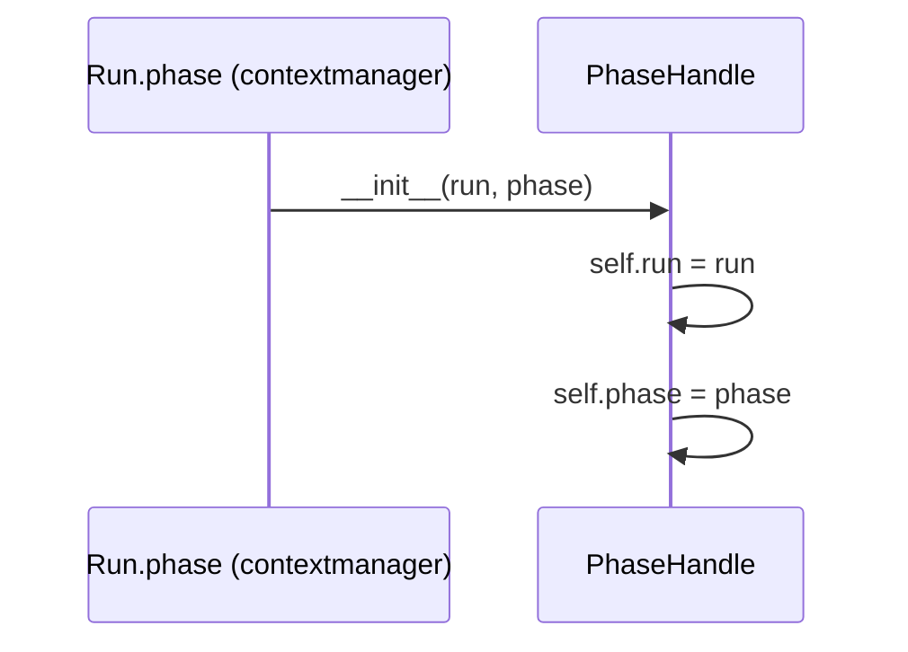
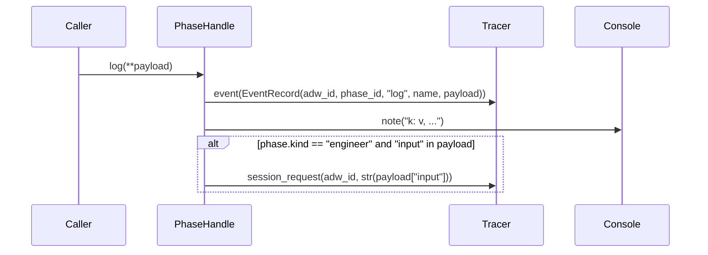
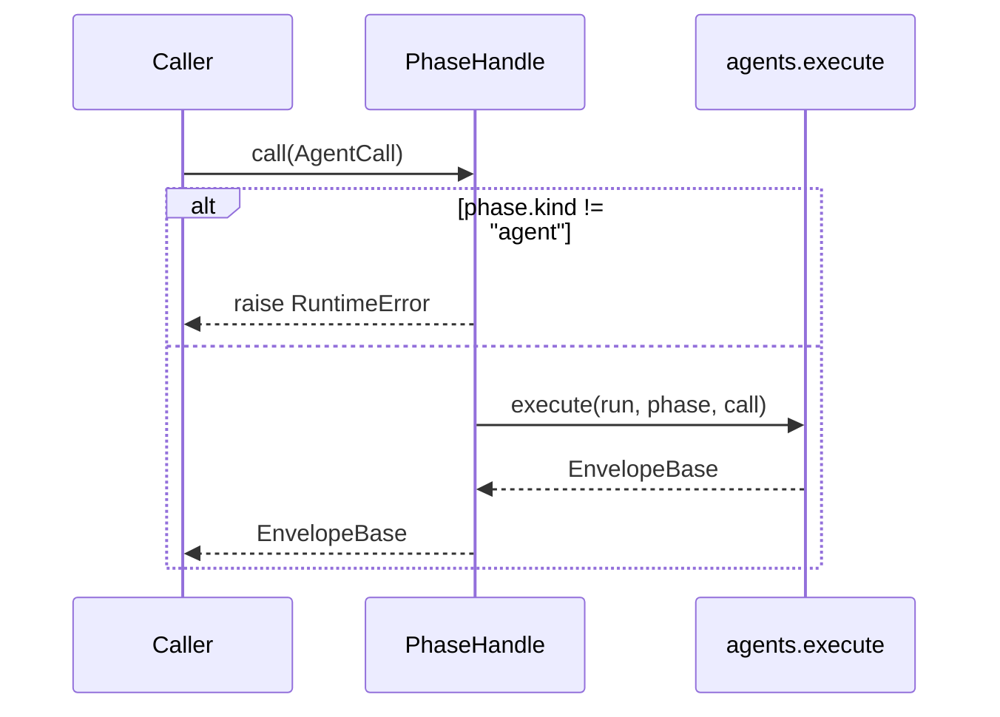
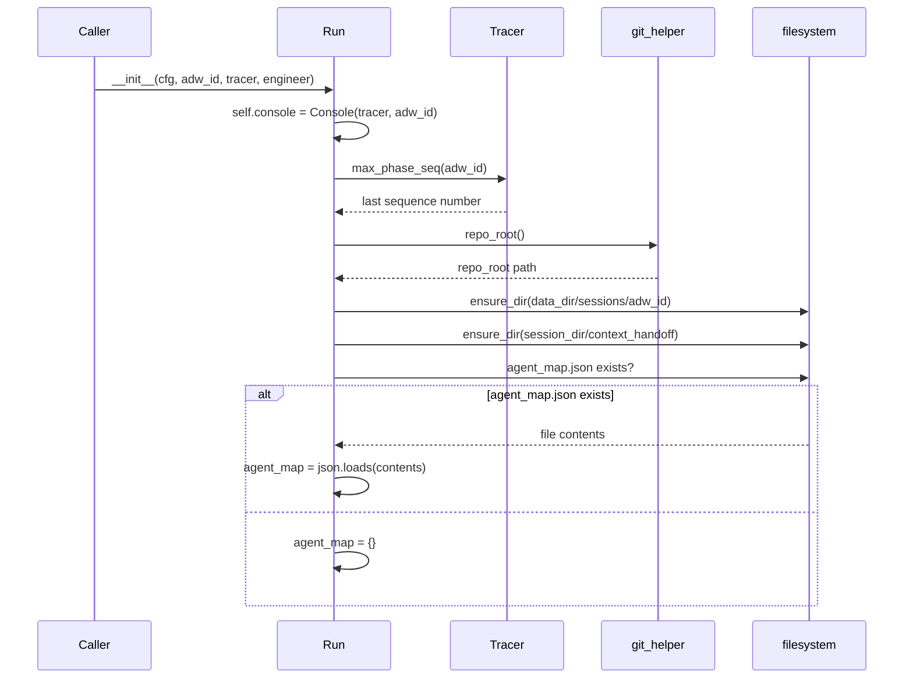
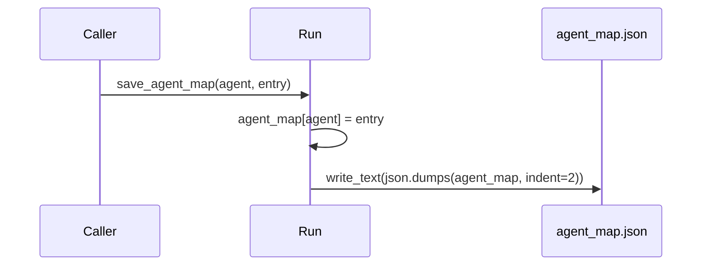
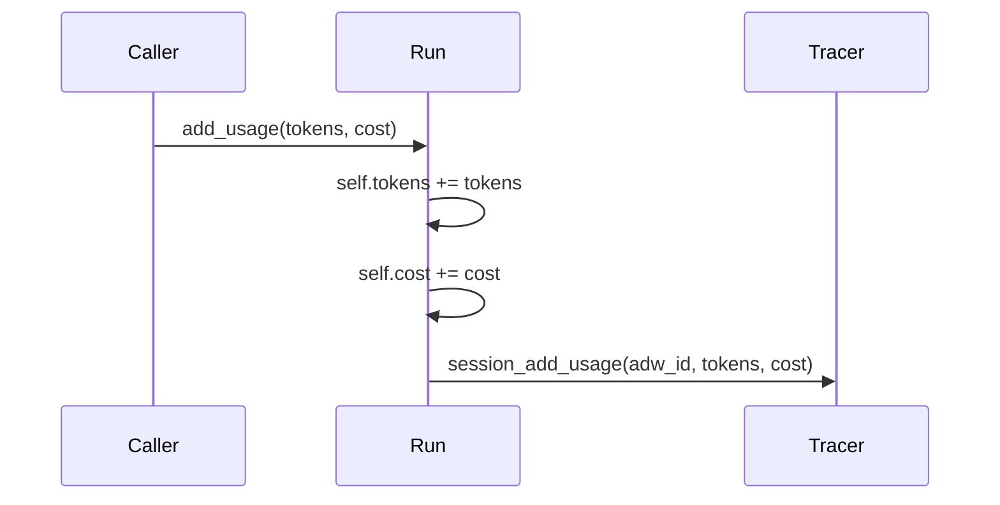
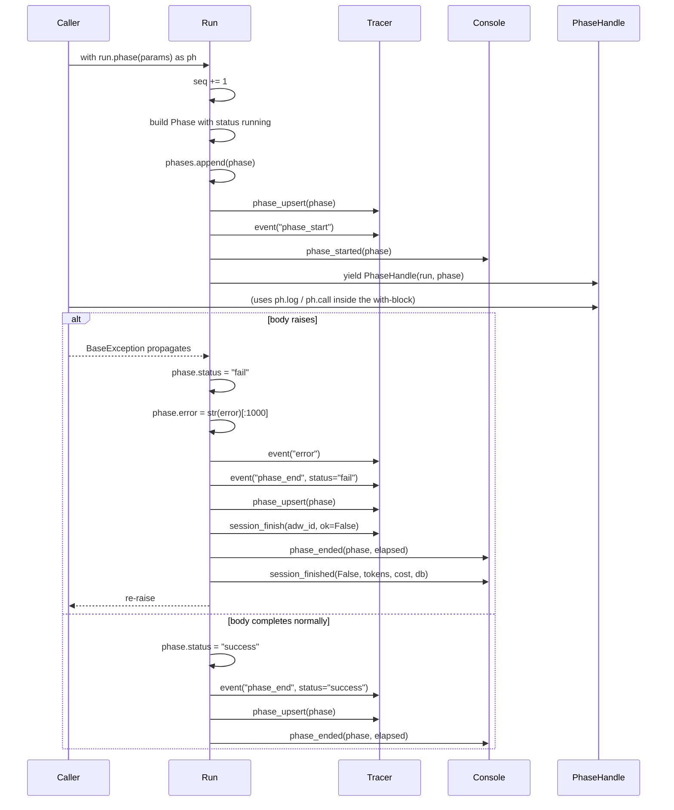
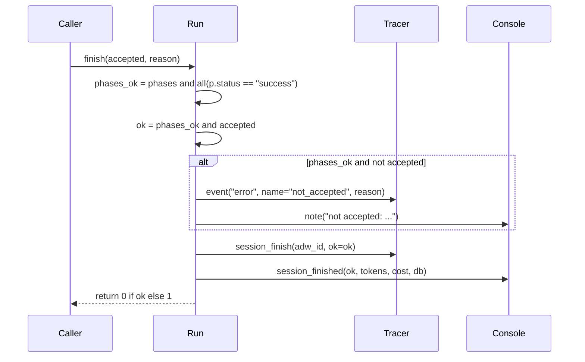

# `runner.py`

The `Run` object: config + `adw_id` + agent map + tracer + console, bound
once per ADW invocation. `run.phase(PhaseParams(...))` is the one phase
primitive — a context manager used for all three phase kinds (`engineer`,
`agent`, `code`). Success must be earned: every phase defaults to `fail`;
only a clean exit flips it to `success` (agent phases additionally require
a parsed envelope + green gates, enforced inside `PhaseHandle.call`, which
delegates to `agents.execute`).

## Classes

- **`PhaseHandle`** — the object yielded by `Run.phase()`. Scopes `log()`
  and `call()` to the phase that is currently open.
- **`Run`** — one per `adw_id`. Owns the tracer, console, session
  directories, agent map, and running token/cost totals.

---

## `PhaseHandle.__init__(self, run, phase)`

Stores a back-reference to the owning `Run` and the `Phase` record it is
scoped to. No side effects beyond attribute assignment.

---

## `PhaseHandle.log(self, **payload)`

Records a structured log event against the current phase, mirrors it to
the console, and — only for `engineer`-kind phases carrying an `input`
key — also records it as a session request on the tracer.

---

## `PhaseHandle.call(self, call: AgentCall) -> EnvelopeBase`

Guards that the current phase is an `agent` phase, then hands off to
`agents.execute` to actually run the agent call and return its parsed
envelope.

---

## `Run.__init__(self, cfg, adw_id, tracer, engineer)`

Builds the run's fixed state: config, id, tracer, a fresh `Console`, the
engineer name, an empty phase list, zeroed token/cost counters, the next
phase sequence number (continuing a joined run via
`tracer.max_phase_seq`), the repo root, the session/context-handoff
directories (created if missing), and the on-disk agent map — loaded from
`agent_map.json` if a previous run already wrote one.

---

## `Run.save_agent_map(self, agent, entry)`

Updates the in-memory agent map and persists the whole map to
`agent_map.json`.

---

## `Run.add_usage(self, tokens, cost)`

Accumulates token/cost totals on the `Run` and mirrors the increment into
the tracer's own sqlite-backed accumulation.

---

## `Run.phase(self, params: PhaseParams)` *(context manager)*

The one phase primitive. Allocates the next sequence number and a `Phase`
record defaulted to `status="running"`, registers it with the tracer and
console, then yields a `PhaseHandle` to the caller's `with` block.

- On a clean exit: marks the phase `success`, records `phase_end`, and
  upserts the final phase state.
- On any exception: marks the phase `fail` (success must be earned),
  records `error` + `phase_end`, upserts the phase, finishes the whole
  session as failed, tells the console, and re-raises — the caller always
  sees its own exception.

---

## `Run.finish(self, accepted=True, reason="") -> int`

Finalizes the run exactly once, settling the db record, the console
banner, and the process exit code together so they can never disagree.
Two criteria must both hold for the run to count as `ok`: every phase
succeeded (`phases_ok`), **and** the caller's own acceptance test passed
(`accepted`) — a phase that ran the test suite did its job even if the
suite came back red, so the phase succeeds while the run must not.

