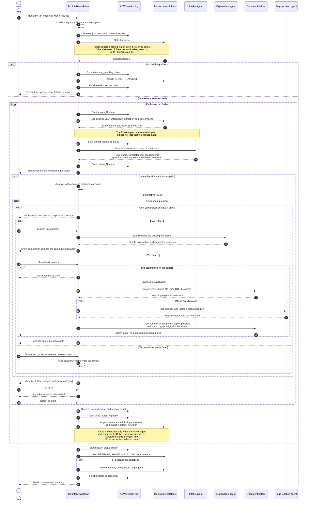

# Tax document intake

Source: [adw_tax_intake.py](adw_tax_intake.py), with supporting behavior from
[tax_intake.py](adw_modules/tax_intake.py) and
[document_localize.py](adw_modules/document_localize.py).

The workflow reads earlier notes about a scanned tax form, finds missing
information, asks you questions, and saves the results. It handles **one folder
per run by default** (`--limit 1`).

**“Done” in `INTAKE_STATUS.txt` means the folder has `intake_notes.txt`.**
Folders with unanswered questions or `needs_info` are also removed from the
automatic pending list once notes exist. Use `--folder <name>` to revisit one.
A successful ADW session means the intake pass finished; tax questions may still
need answers. This workflow records information and does not decide tax treatment.
