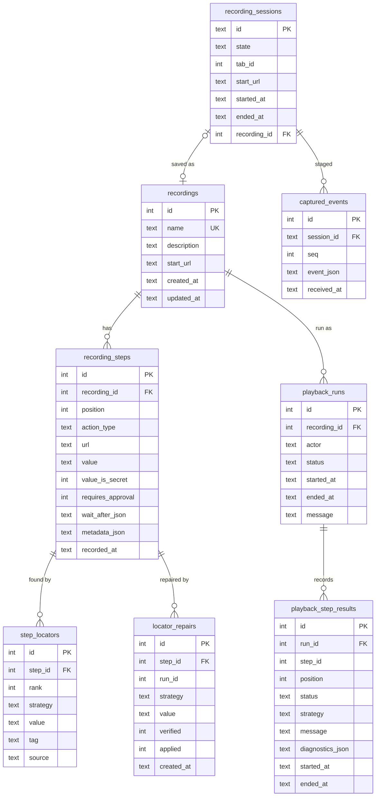
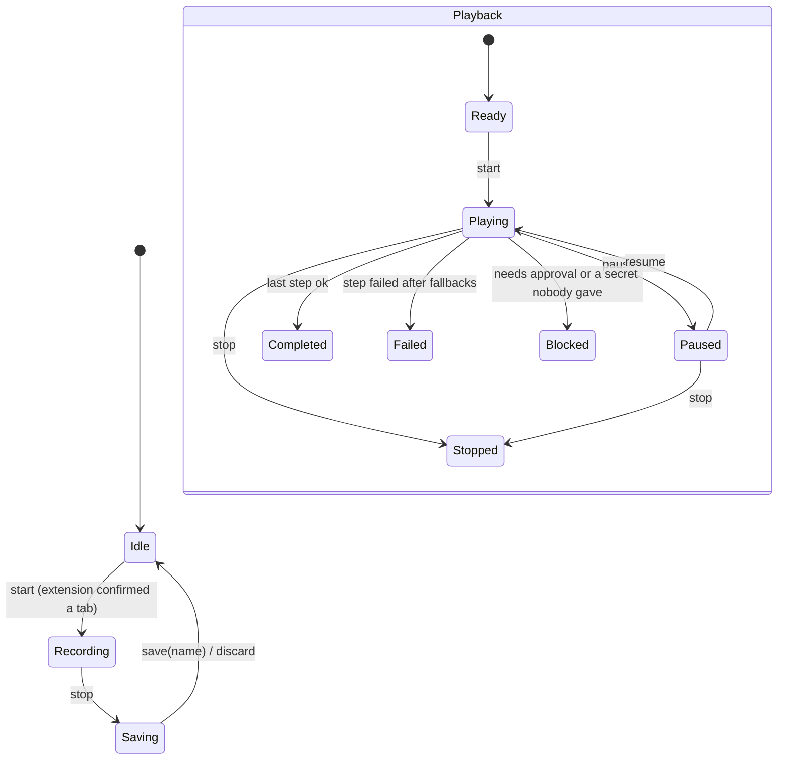
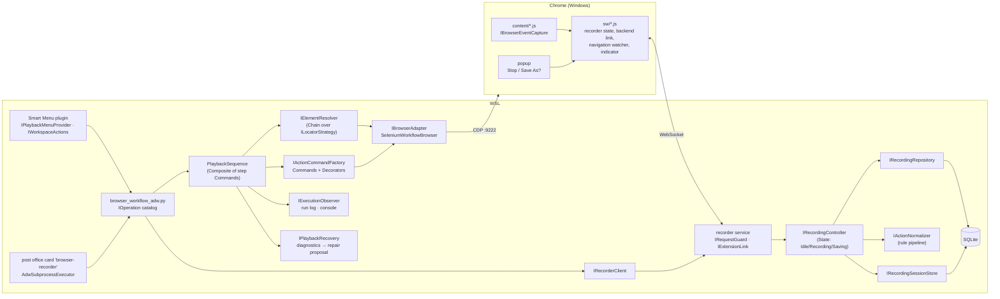
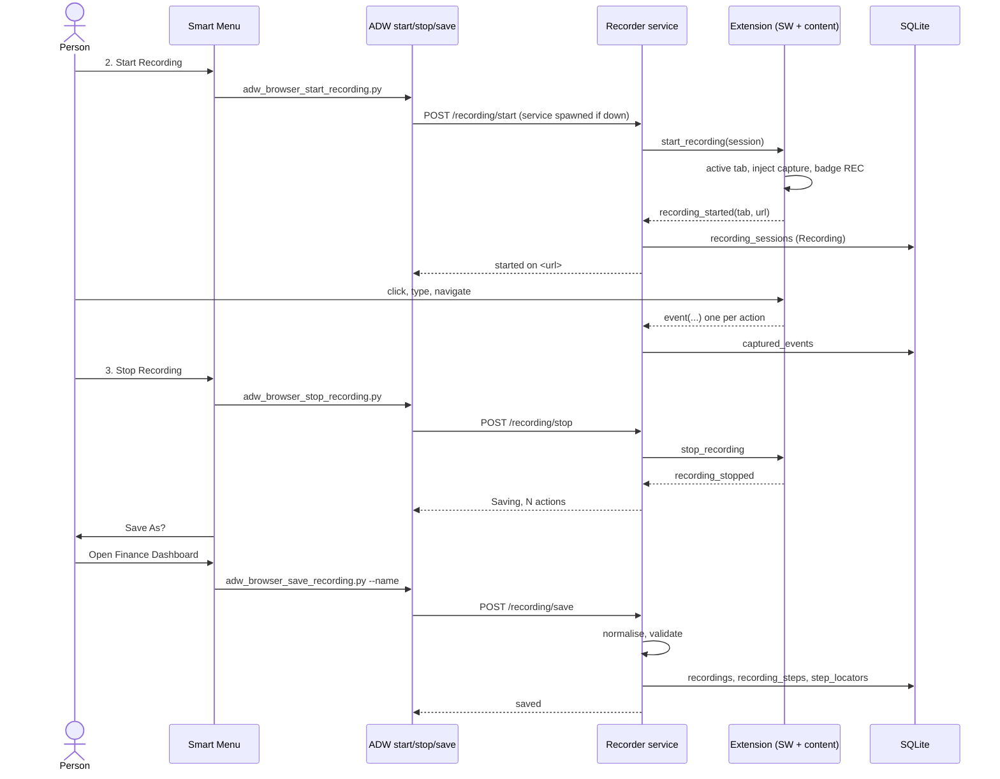

# Browser Workflows — record once, replay from the menu, an ADW, or an agent

This subsystem sits beside `browser_session/` (the Fifth Third "Log In" click)
and reuses it rather than replacing it. Every behaviour lives behind an
`I`-prefixed Protocol in `interfaces/`; `kit.py` is the one module that names
concrete classes.

## What is reused, and what is new

| Need | Reused from | New here |
|---|---|---|
| Reach a Chrome the user already has open | `browser_session`: `SeleniumAttachedDriverFactory`, `SeleniumHeadlessManagerFactory` (selenium-headless's `WebBrowserManager`), `StopDriverServiceDetach` (never quit), `DevToolsEndpointProbe` | `SeleniumWorkflowBrowser`, an `IBrowserAdapter` with typing, selects, screenshots and page queries |
| Open that Chrome with a debug port | `adw_interface_browser_debug_open.py`, unchanged | — |
| One engine for many small ADWs | `agent_comms.operations.base`: `IOperation`, `OperationOutcome`, `OperationSequence` | `browser_workflow_adw.py`, the harness that `post_office_adw.py` is for the post office |
| Agents discovering and requesting work | `agent_comms`: `agents.json` cards, `KeywordRouter`, `ByTaskType`, `AdwSubprocessExecutor`, `FailureForwarder` to the mechanic | one card (`browser-recorder`) and one runtime builder |
| A console menu | `/home/adamsl/smart_menu`'s `Menu` loop (any item with `title` + `execute()`) | items built from SQLite every time the list opens |
| Recording what a person does | nothing existed | the MV3 extension in `chrome_extension/` and the recorder service |

## The Windows / WSL boundary

```
 Windows                                   WSL2 (networkingMode=mirrored)
 ───────────────────────────────           ─────────────────────────────────────
 Chrome (debug profile, port 9222)         recorder service  127.0.0.1:8781
   └─ Browser Recorder extension  ──ws──►    (aiohttp; Host + Origin guarded)
        service worker                        └─ SQLite click_workspace_sequences.db
   ▲                                                 ▲
   └──── CDP 127.0.0.1:9222 ◄── playback (Selenium via WebBrowserManager)
```

Mirrored networking makes 127.0.0.1 the same address on both sides (measured:
`curl.exe` on Windows got HTTP 200 from a WSL listener). So the extension
opens a WebSocket straight to the service; Native Messaging would need a
Windows-registered host executable and adds nothing here.

The service accepts a connection only when:
* `Host` is `127.0.0.1:<port>` or `localhost:<port>`, which defeats DNS rebinding;
* for the WebSocket, `Origin` is exactly `chrome-extension://<our id>`. The
  manifest's `key` pins the ID, so a web page can never pass this check;
* for the control API, no `Origin` at all (a CLI or ADW) and
  `Content-Type: application/json`, which a cross-site form cannot send
  without a preflight we never answer.

## Recording protocol (JSON over the WebSocket)

| direction | type | payload |
|---|---|---|
| ext → svc | `hello` | `extension_version`, `state` |
| svc → ext | `start_recording` | `session_id` |
| ext → svc | `recording_started` | `session_id`, `tab_id`, `url`, `title` |
| ext → svc | `event` | `session_id`, `event` (a `RawBrowserEvent`) |
| svc → ext | `stop_recording` | `session_id` |
| ext → svc | `recording_stopped` | `session_id`, `event_count` |
| ext → svc | `start_requested` | from the popup's Start button (the service then sends `start_recording`) |
| ext → svc | `stop_requested` | `session_id`, from the popup's Stop button |
| ext → svc | `save_requested` | `session_id`, `name`, from the popup's "Save As?" |
| ext → svc | `discard_requested` | from the popup's Discard button |
| svc → ext | `state` | `state`, `session_id`, `message` |
| both | `ping` / `pong` | keeps the MV3 service worker alive |

Raw events are what the page saw: `click`, `text_committed` (one per field,
on `change`, never per keystroke), `select`, `check`, `key` (Enter),
`navigation` (with Chrome's `transition_type`) and `tab_switch`. Secrets never
leave the page. A sensitive field's value is replaced by `null` and
`sensitive: true` in the content script, then checked again in Python against
the same `sensitivity_rules.json`.

## Normalising: raw events → reusable actions

`ActionNormalizer` is a pipeline of single-purpose rules (Strategy objects, in order):

1. `MapRawEvents`: each raw event becomes a `RecordedAction`.
2. `DropFieldFocusClicks`: a click into a field that is then typed into is noise.
3. `MergeTextEntries`: consecutive entries into one field keep only the last value.
4. `FoldFollowedNavigation`: a `link`/`form_submit` navigation right after a
   click becomes that click's `wait_after: url_equals`, not a separate step.
5. `RedactSecrets`: re-applies the sensitivity rules; the value is dropped
   and the step asks a person at playback.
6. `FlagConsequentialSteps`: Pay / Transfer / Delete / Submit-style
   clicks are marked `requires_approval`.
7. `EnsureStartsWithNavigation`: playback always begins on the recorded page.

## SQLite: `adws/adw_data/browser_workflows/click_workspace_sequences.db`



## State machines (State pattern)



An illegal transition (stop while Idle, save while Recording) raises
`IllegalTransition` and changes nothing.

## Architecture



## Sequence: recording and saving



## Sequence: playback

`ExecutePlayback` configures `Browser.setDownloadBehavior` with `allow` and
an absolute native download folder before any recorded steps. This covers new
tabs as well as the current tab and avoids operating-system Save As dialogs,
which the extension cannot capture. The default folder is Downloads/BrowserRecorder;
a local `download_directory.txt` or `BROWSER_WORKFLOW_DOWNLOAD_DIR` can override it.
Download configuration errors stop playback before clicks. This currently
configures delivery only; run completion does not verify file completion/content.

```mermaid
sequenceDiagram
    participant C as Menu / ADW / agent
    participant P as PlaybackSequence
    participant D as SQLite
    participant B as Chrome via CDP
    C->>P: execute_playback(name)
    P->>D: load_recording
    P->>P: validate_playback
    P->>B: acquire_session (attach, never launch, never quit)
    loop every step
        P->>B: locate_element (candidates in rank order)
        P->>B: wait_for_element (visible, enabled)
        P->>P: approval gate / secret source if the step needs one
        P->>B: execute_action (Command)
        P->>B: wait_after (url, ready state)
        P->>D: log_result (playback_step_results)
    end
    alt a step fails
        P->>B: diagnose_failure (url, title, screenshot, similar elements)
        P->>D: diagnostics_json; mechanic can read it
    end
    P->>B: release (chromedriver stops; Chrome stays open)
    P-->>C: report_completion
```

## Self-healing, with a person in the loop

1. The step's other recorded locators are tried in rank order (deterministic).
2. If none works, `diagnose_failure` stores url, title, a screenshot, what each
   locator found (nothing, too many, hidden, zero size, disabled), and the page's visible
   interactive elements ranked by similarity to what was recorded.
3. `adw_browser_repair_locator.py --run-id R` proposes the best similar element,
   or takes `--css` from the mechanic or a person. It verifies the proposal on
   the live page by locating only, never clicking. It saves the proposal as
   unapplied.
4. `--apply` (a person's decision) makes it the step's first locator. A
   repair never clicks, and an unverified proposal can't be applied.

## Agents: the `browser-recorder` card in the post office

Toyota, Sydney, Sonnet, Opus and the mechanic reach playback the way they
reach each other: through `lancedb_memory/agent_comms/`. The `browser-recorder` card in
`agents.json` runs on the generic `adw` runtime, `AdwSubprocessExecutor` with
the command `uv run --quiet`, against `adws/adw_browser_agent_request.py`.
The request text goes in as the first argument, and `--verdict` makes the
harness end on a `DONE:` or `REFUSED:` line, which becomes the reply.

    "browser recorder: list playbacks"         -> DONE: saved playbacks: ...
    "have the browser recorder run pay bill"   -> runs it, or REFUSED: why

`AgentRequest` matches the request to one saved playback with
`IPlaybackMatcher`, then runs it with nothing but `{ name, actor, port }`. Its
gates are `DenyApprovalGate` and `NoSecretSource`, so an agent can never
approve a consequential step or supply a password. Those steps block, and the
refusal says which step it was and why, so a person can rerun it from the menu
with `--interactive`. A failed playback is a failed task like any other: the
caller is alerted and `FailureForwarder` sends it to the mechanic. The card is
`idempotent: false`, so it is never retried, because a half-run playback
replayed from the top could submit a form twice.
