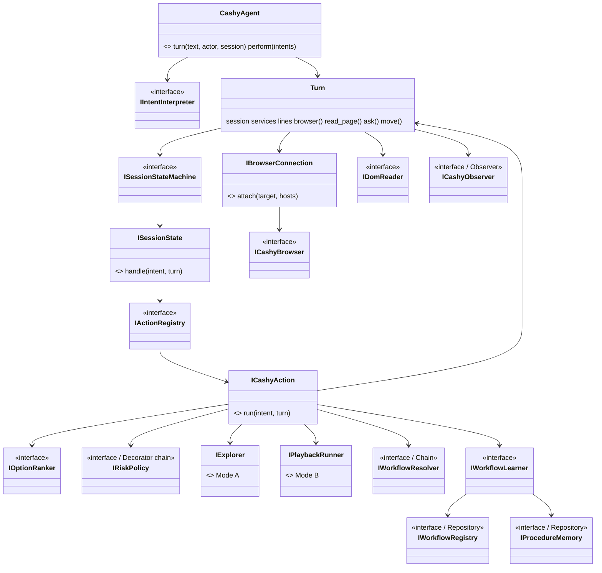
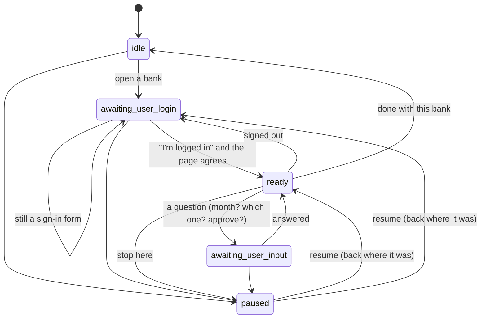

# Cashy -- design

Cashy is a banking navigation agent. She reads a bank page's DOM, never a
picture of it, and the person signs in themselves. Whatever she learns
becomes a versioned browser playback that she, the Smart Menu, Toyota and
Sydney all run the same way.

## Where things are true

| store | holds | never holds |
|---|---|---|
| SQLite `adw_data/browser_workflows/click_workspace_sequences.db` | the executable steps (the `browser_workflows` playbacks), their runs, Cashy's workflow **versions** (`cashy_workflows`), sessions, downloads, account→bank hints | field values, cookies, query strings, full account numbers |
| LanceDB `adw_data/cashy/lancedb` | one sentence per learned procedure plus a pointer (`bank, goal, playback, version`) | a step, a page, an amount |
| `adw_data/cashy/events.jsonl` | what happened, turn by turn (state changes, activities) | page text |
| nothing | passwords, MFA codes, security answers, cookies, balances | -- |

LanceDB remembers *that* something was learned, and SQLite holds *how* to
run it. A memory whose version is gone just resolves to nothing; it is
never replayed from the memory itself.

## The pieces



Every interface lives in `interfaces/` and every concrete class is named
only in `kit.py` (`CashyKit`, the composition root). The modules are:

| package | single purpose |
|---|---|
| `conversation/` | a sentence becomes `Intent`s. Each phrase family is one `IIntentRule` (Strategy) and the first rule that matches wins. No model is involved. |
| `session/` | the five resting `ISessionState`s and `TableStateMachine`, which raises on an illegal move |
| `actions/` | one `ICashyAction` (Command) per intent kind, held in `MapActionRegistry` |
| `page/` | `DomPageReader` (numbered options from the DOM), `TokenOptionRanker`, `HeadingArrivalCheck`, and the risk policy chain |
| `navigation/` | `GuardedOptionClicker` (risk, then approval, then a trusted CDP click), `GuidedExplorer` (Mode A), `OperationPlaybackRunner` (Mode B, through `execute_saved_playback`), `CalendarStatementLocator` |
| `learning/` | `TrailWorkflowLearner` (trail → playback → template → version → memory), the `FirstResolver` chain (learned version, then the hand-made statement catalog), and the LanceDB memory |
| `documents/` | the download watcher, verifier (size, PDF magic number, sha256) and ledger |
| `finance/` | the person's transfer records, read from `transfer_pay_activity.txt`, used as hints only |
| `storage/` | SQLite repositories and `MaskingSanitizer` (applied before any session is saved) |
| `observing/` | JSONL and console observers, and `CaseFileReporter`, which writes the Mechanic's case files |
| `banks/` | `BankProfile`s as data. Adding a bank means adding one entry. |
| `connection.py` | `PinnedTabConnection`: stays on the tab Cashy opened, and only on that bank's hosts |
| `operations.py` | the same work as `browser_workflows` `Operation`s, one thin `adws/adw_cashy_*.py` each |
| `launching.py` | `LaunchingConnection`, a Decorator that starts the debug Chrome (through `adw_interface_browser_debug_open.py`, its own profile) only when nothing answers on its port |
| `presenting/menu.py` | the "Cashy — Banking Automation Workspace" Smart Menu |
| `presenting/desk.py`, `presenting/sidecar.py`, `presenting/handoff.py` | her dashboard desk: the receptionist sidecar contract on loopback :8770 |

## States: resting vs. doing

The mission lists thirteen states. Cashy separates the states a session
**rests** in between messages from the **activities** a turn passes through
on the way. The first are GoF State objects that persist with the session.
The second are events reported to observers, so they are watchable, and
nothing rests in them.

| mission state | here |
|---|---|
| IDLE, AWAITING_USER_LOGIN, AWAITING_USER_INPUT, PAUSED | resting states of the same names |
| (signed in, nothing pending) | `ready` |
| CONNECTING, NAVIGATING, INSPECTING_DOM, EXECUTING_ADW, EXPLORING, DOWNLOADING, LEARNING, COMPLETED, FAILED | `Activity` events |

The *task* (goal, period, account, mode, status) is separate from the
session state: `CashySession.task`.



`AwaitingLoginState` refuses clicks and navigation until the page shows the
bank's signed-in words. A question remembers the request it completes
(`Question.resume`), so an answer picks up where the request stopped.

## A statement download

```mermaid
sequenceDiagram
    actor P as person
    participant A as CashyAgent
    participant R as IWorkflowResolver
    participant B as IPlaybackRunner (Mode B)
    participant E as IExplorer (Mode A)
    participant D as watcher/verifier/ledger
    participant L as IWorkflowLearner
    P->>A: "download my September 2025 statement"
    A->>D: already downloaded? (bank, account, period)
    A->>R: a verified route to statement_download?
    alt known
        R-->>A: playback vN
        A->>B: run vN for 2025-09 (execute_saved_playback --period)
        B-->>A: ok / failed
        Note over A: on failure: a case file for the Mechanic, then Mode A
    else unknown
        A->>E: explore to "statements" (rank links, risk check, click, re-read)
        A->>A: CalendarStatementLocator finds the September 2025 link
        A->>A: trusted CDP click (downloads go to the folder, no dialog)
    end
    A->>D: wait, verify (PDF, size, sha256), record (masked account)
    A-->>P: saved to …; not imported into the books
    P->>A: "remember how you did that"
    A->>L: trail → playback → {month_name} template → candidate vN+1 → LanceDB pointer
    Note over L: a later successful run marks vN+1 verified; vN is kept
```

## Safety, and where each rule is enforced

- **No pictures.** `CdpWorkflowBrowser.screenshot()` always returns False,
  and no module imports Playwright or Selenium. A page with nothing
  actionable in its HTML gets `CANNOT_READ`, which asks the person for help.
- **The person signs in.** No action types into a field. `AwaitingLoginState`
  waits, and the reader detects a sign-in form by its password `input` type
  without ever reading a value.
- **Consequential steps.** `GuardedOptionClicker` asks the `IRiskPolicy`
  chain (`NamedDestinationRiskPolicy` → `ReadOnlyAwareRiskPolicy` →
  `KeywordConsequenceClassifier`). If the step is consequential, Cashy asks,
  and only `actor == "user"` can say yes. An agent gets "Only the person at
  the keyboard can approve that." "Pay & transfer" as a navigation link is
  allowed, but "Send money" and "Make a payment" never are.
- **Transfer activity is read-only.** A matching payee from the person's own
  records is a hint, confirmed by asking. The reply says nothing was
  changed and that Cashy won't start a transfer.
- **Downloading isn't importing.** No Cashy module writes to the finance
  database.
- **Sanitized storage.** `MaskingSanitizer` strips query strings, masks money amounts and
  digit runs in paths and text to `•1234`, and drops field values. Hosts and
  ports are left alone so a learned start URL still works.
- **Loopback only.** `cdp_browser`'s `LoopbackOnly` refuses a non-local
  DevTools endpoint.
- **Page text is data.** Page text is only matched against words. It is
  never sent to a model as instructions, and no model is in the navigation
  path at all.
- **Versions are never overwritten.** A repair registers vN+1 as a
  candidate, and vN stays until vN+1 verifies.

## The dashboard

Cashy talks to the dashboard the way Toyota and Sydney do. `adw_cashy_service.py`
(unit `cashy-agent`, `deploy/cashy-agent.service`) serves receptionist_team's
sidecar contract on **127.0.0.1:8770 only**: `GET /health`, `GET /alerts`,
`POST /turn` (NDJSON `TurnRecord`s, imported from
`receptionist_team.service_models` so there is one definition),
`POST /compact`, `POST /alerts/ack`. The dashboard's `cashy_service.py` puts her
on the same `SidecarBridge`, lists her in Agent Management as `agent-cashy`, and
her Input Options page is the same `ReceptionistDesk` Toyota's box is, on
`/api/cashy-turn`. The dashboard person is `actor="user"`, so they can approve;
the post office's `cashy` card cannot. Her session is `default`, the one
`adw_cashy_chat.py` uses, so the terminal and the dashboard continue the same
conversation. "Put Toyota on" returns a hand-off record (the list is
`receptionist_team`'s `HANDOFF_AGENTS`, which now includes `cashy` so Toyota and
Sydney can open her window too). She must run on the machine whose Chrome she
drives.

## Running

```bash
cd /home/adamsl/agent_blocks
uv run adws/adw_interface_browser_debug_open.py "cashy" --url about:blank   # Windows debug Chrome, port 9222
uv run --quiet adws/adw_cashy_chat.py                                        # talk to her
uv run --quiet adws/cashy_menu.py                                            # the Smart Menu
uv run --quiet adws/adw_cashy_request.py "status" --actor toyota --verdict   # what the post office runs
```

Tests (the live ones need a headless Chrome with a DevTools port):

```bash
cd adws && CDP_TEST_PORT=9333 uv run --quiet --with pydantic --with pytest --with aiohttp \
    --with lancedb --with pyarrow pytest -q cashy/tests cdp_browser/tests browser_workflows/tests
```

`tests/fake_bank.py` is a local bank site with a sign-in page, statements,
"Pay & transfer", transfer activity and payment buttons. The acceptance
conversation in `test_cashy_live.py` runs against it.
