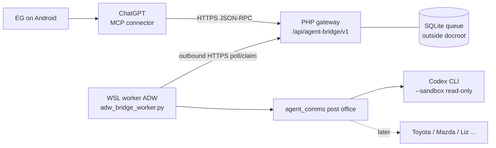
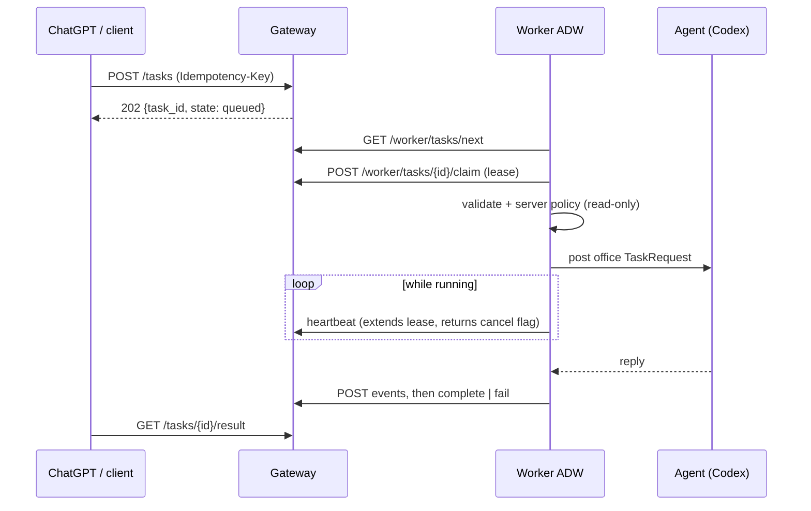
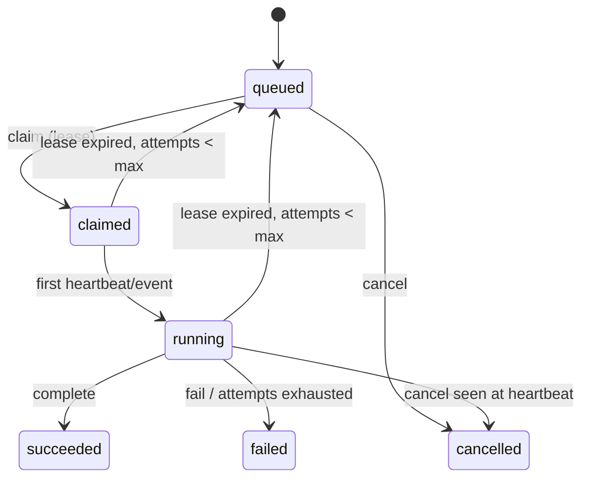

# Agent Bridge — Architecture

ChatGPT (or any client holding a client token) submits a structured task to a
PHP gateway. A worker in WSL reaches **out** to it over HTTPS, so the home
machine opens no inbound port. The worker then hands the task to an agent
through the existing post office.

## Layout

| Piece | Path | Role |
| --- | --- | --- |
| Gateway | `agent_bridge/gateway/src/` | `GatewayApp` (routing), `SubmitWorkflow`, `Policy`, `TaskState` (State), `SqliteStore` (repository + leases + audit), `McpEndpoint` (Adapter onto the same workflow), `Contracts.php` (interfaces) |
| Schema | `agent_bridge/gateway/migrations/001_init.sql` | tasks, task_events, task_results, worker_leases, agent_registry, audit_events, schema_migrations |
| Tooling | `agent_bridge/gateway/bin/` | `migrate.php`, `issue_token.php` (tokens stored hashed, printed once, revocable) |
| Worker logic | `lancedb_memory/agent_bridge_worker/` | `service.py` (BridgeTaskRun), `policy.py` (ReadOnlyPolicy), `ports.py` (Protocols), `models.py` (Pydantic) |
| Worker adapters | `agent_bridge_worker/adapters/` | `HttpTaskGateway` (https only, token never in repr), `PostOfficeAgent` (IAgentAdapter over agent_comms) |
| ADW | `adws/adw_bridge_worker.py` | composition root; one SSSF session per task; `--drain` for a bounded batch |
| Agent | `agent_comms/executors/codex_cli.py` + `codex` card in `agents.json` | read-only sandbox, accepts only from `chatgpt-bridge` |

## Interfaces → implementations

| Interface | Implementation |
| --- | --- |
| ITaskGateway | `GatewayApp` (server), `HttpTaskGateway` (worker side) |
| ITaskRepository, ITaskLeaseManager, IAuditLogger | `SqliteStore` |
| ITaskAuthenticator | Audited(FirstMatch[bearer-token table, OAuth access tokens]) — see SECURITY.md, OAuth section; routes `/.well-known/oauth-*`, `/oauth/{register,authorize,token}` |
| ITaskAuthorizer, IExecutionPolicy | `Policy` (gateway) + `ReadOnlyPolicy` (worker) — both must agree |
| ITaskValidator | `SubmitWorkflow` envelope checks |
| IAgentRegistry | gateway `agent_registry` table + post office `agents.json` |
| IAgentAdapter | `PostOfficeAgent` |
| IWorkflowOrchestrator | `adw_bridge_worker.py` phases |
| IResultPublisher | worker `complete`/`fail`/`events` calls |
| IMemoryProvider | `search_agent_memory` routed as a read-only `search_memory` task to the memory agent |

## ADW phases (worker)

| Phase | Responsibility | Failure / recovery |
| --- | --- | --- |
| ClaimTask | `next` + atomic `claim` | lost claim → stop quietly |
| ValidateTask / AuthorizeTask | envelope + server-side read-only policy | refused → `fail` with reason |
| ResolveAgent / ResolveWorkspace | card lookup, `accepts_from`, workspace allow-list | unknown → `fail` |
| ExecuteAgent | post office send, heartbeat, watch cancel | cancel → withdraw; lease lost → publish nothing |
| CollectEvents / PublishResult / FinalizeTask | events, then `complete` or `fail` | gateway retries on lease expiry up to `max_attempts` |

Receive/Authenticate/Validate/Queue run inside the gateway's `SubmitWorkflow`.
The educational phase split is heavier than production needs; the services are
plain classes, so the ADW can be replaced by a loop.
