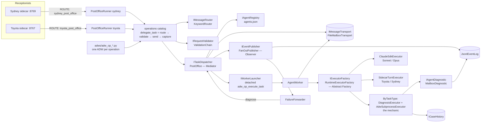

# agent_comms — the team post office

Any registered agent can send work to any other: synchronously (send and wait
for the reply), asynchronously (send, carry on, collect the reply later), or
through the shared board and event log. It is Swarm-Forge's handoff mailboxes
translated into Python on our own interfaces and ADW lifecycle.

## Why it exists

On 2026-10-28 EG asked Sydney to "get Sonnet to replicate the communication
system that's in Swarmforge … tell Sonnet to make that happen." Sydney answered
"I'm only set up to pass a question to Sonnet … not to execute build/training
tasks." Traced end to end:

| layer | what it did | real limit? |
|---|---|---|
| Sydney's system prompt | Sonnet was reachable **only** as `ask_sonnet` ("a quick second opinion") — no route for work | no — our prompt |
| `ask_sonnet` dispatcher (a Claude SDK turn, `ToolAgentRunner`, cwd `rol_finances`) | its user prompt said "If there is no actual question there, ask what they want … and stop", so it stopped. That turn's own cwd is why it called the request "unrelated to anything in this finance codebase" | no — our prompt |
| `rol_finances` `adw_ask_sonnet.py` / SSSF `ask_sonnet` agent | never ran (no session after `b2f4abda`, the earlier find-the-repo question) | — |
| the `ask_sonnet` SSSF agent, had it run | `writes: []`, tools `read, grep, find, ls` — a read-only advisor by configuration | config, not provider |
| Claude (Sonnet/Opus) via the Agent SDK | builds with Bash/Read/Write/Edit every day (`dashboard_expert`, the mechanic's coder) | **no limit** |
| `mechanic_translator` (the follow-up) | said toyota_mechanic "can't touch Sydney's code" — its prompt predates Sydney, who *is* the same package | stale prompt |

So the request was rejected **before reaching Sonnet**, by orchestration code
and prompts. Nothing at the provider refused it. The existing delegation interface
(`IDelegationRunner`) could be extended rather than replaced, and it was:
`PostOfficeRunner` is one more runner.

## Swarm-Forge, and what we took

`/home/adamsl/swarm-forge` (on DESKTOP-2OBSQMC; github.com/unclebob/swarm-forge).
Languages: **Babashka** (Clojure scripting, `.bb`, 12 scripts), shell wrappers
(`.sh`, 17), Clojure tests (`.clj`), prompt files. The agents themselves are
CLI coding agents in tmux panes.

| Swarm-Forge | here | kept / changed |
|---|---|---|
| per-role `inbox/{new,in_process,completed}`, `sent/`, `failed/` | `FileMailboxTransport` | kept: state = which box a file is in |
| `priority_timestamp_seq_from_sender` filenames | `NN_<id>.json`, id `<utc>_<hex8>_from_<sender>` | kept: lowest priority first, then time |
| atomic write via `tmp/` + rename | same | kept |
| `swarm_handoff.sh` strict validator | `IRequestValidator` chain | kept: one validation boundary |
| `handoffd` daemon delivering outbox → inboxes | sender's own atomic rename | **changed**: no daemon needed; no tmux isolation to cross |
| lossy tmux wake-ups, durable inbox | `IWorkerLauncher` (detached ADW spawn) | kept: wake is a hint, inbox is the truth |
| `ready_for_next` / `done_with_current` | `AgentWorker.work_one` / `drain` | kept; claiming is an atomic rename so two workers never run one task |
| header audit (`enqueued_at`, `dequeued_at`, `completed_at`) | `Envelope` fields + `state.advance` | kept, in Pydantic |
| `roles.tsv` registry | `agents.json` + `IAgentRegistry` | extended with **capabilities** |
| message types `git_handoff`, `note` | `task_type` per capability card | generalised |
| — | request/reply by correlation id | **added**: SF has no reply channel |
| — | retries, recovery, cancellation, mechanic | **added** |

Not taken: tmux, git-commit handoffs, fixed pipelines (specifier → coder → …).

## Architecture



Sydney → Sonnet, a build (asynchronous), then the status check:

```mermaid
sequenceDiagram
    actor EG
    participant Sy as Sydney (RoutingModel)
    participant Rn as PostOfficeRunner
    participant PO as PostOffice
    participant MB as Mailboxes
    participant W as AgentWorker (sonnet)
    participant So as ClaudeSdkExecutor (claude-sonnet-5)
    EG->>Sy: "Get Sonnet to replicate … make that happen"
    Note over Sy: PostOfficeRoute forces sydney_post_office (no model vote)
    Sy->>Rn: run(extra = the user's words)
    Rn->>PO: delegate_task: route → validate → send
    PO->>MB: deliver to sonnet/inbox/new (copy in sydney/sent)
    PO-->>W: wake (detached ADW run)
    PO-->>Rn: receipt (task id, asynchronous)
    Rn-->>Sy: "I've sent that to Sonnet as task 3f2a9c1e…"
    Sy-->>EG: says it
    W->>MB: claim → in_process
    W->>So: execute(envelope)
    So->>So: run_role(build brief, Bash/Read/Write/Edit, cwd = repo)
    So-->>W: TaskResult(ok, summary, cost)
    W->>MB: complete; reply → sydney/inbox/new
    EG->>Sy: "what's the status of my tasks?"
    Sy->>Rn: task_status
    Rn-->>Sy: "build for sonnet is succeeded: …"
```

A quick question (`ask`, `message`) is the same path with `wait_seconds > 0`:
the sender's `capture_response` step polls its own inbox for the reply's
correlation id. A wait that times out loses nothing: the reply is kept.

## Interfaces (`ports.py`)

| interface | one job | implementations |
|---|---|---|
| `IAgentRegistry` | who exists, their cards | `JsonAgentRegistry`, `InMemoryAgentRegistry` |
| `IMessageRouter` | free text → addressed `TaskRequest` | `KeywordRouter` (deterministic; swap for a model) |
| `IRequestValidator` | one reason to refuse | `RegisteredParties`, `AcceptsSender`, `HasCapability`, `NoLoopBack`, `ValidationChain` (Composite) |
| `IMessageTransport` | durable mailboxes | `FileMailboxTransport` |
| `ITaskExecutor` | one agent runtime (Adapter) | `ClaudeSdkExecutor`, `SidecarTurnExecutor`, `DiagnosisExecutor`, `AdwSubprocessExecutor`, `HelloWorldExecutor`, `ByTaskType` (Strategy), `ObservedExecutor` (Decorator) |
| `IExecutorFactory` | card → executor (Abstract Factory) | `RuntimeExecutorFactory` |
| `IWorkerLauncher` | make sure someone works an inbox | `DetachedWorkerLauncher`, `RecordingLauncher` |
| `ITaskDispatcher` | validate, address, post, maybe wait (Mediator) | `PostOffice` |
| `IRequestReply` | wait for a correlated reply | `MailboxReplyWaiter` |
| `ITaskBoard` | shared read view | `MailboxTaskBoard` |
| `IEventPublisher` / `IEventSubscriber` / `IEventLog` | Observer | `FanOutPublisher`, `JsonlEventLog`, `FailureForwarder`, `RecordingSubscriber` |
| `IRetryPolicy` | may this run again? | `IdempotentRetries`, `NeverRetry` |
| `IAgentDiagnostic` | everything about one failure | `MailboxDiagnostic` |
| `ICaseHistory` | failures + corrections, for next time | `JsonlCaseHistory` |

Lifecycle is a State table (`state.py`): queued → running → succeeded / failed /
back to queued (a retry); queued → cancelled. Anything else raises.

`factory.py` is the only module that names concretes. A new agent on an
existing runtime is **one entry in `agents.json`**. A new runtime is one
builder in `default_builders`.

## The five agents

| agent | runtime | can do (its card) | how it is reached |
|---|---|---|---|
| Toyota | `sidecar` → `POST :8767/turn` | ask, message | her own sidecar answers, with her memory and routes |
| Sydney | `sidecar` → `POST :8769/turn` | ask, message | same |
| Sonnet | `claude_sdk`, `claude-sonnet-5`, Bash/Read/Write/Edit/Glob/Grep | build (not idempotent), plan, review, ask, message | `ClaudeSdkExecutor` over `finance_team`'s `run_role` (auth unchanged: subscription OAuth, `env=` backstop intact) |
| Opus | `claude_sdk`, `claude-opus-5-5`, same tools | same | same |
| the mechanic | `mechanic` | diagnose (code-only facts + case history), repair (`adws/adw_toyota_mechanic.py`, sandboxed, gated) | `ByTaskType` |

`hello-world` is a sixth, trivial agent that proves a path end to end;
`post-office` is the sender identity `FailureForwarder` uses.

Guarantees that matter:
* **Never lose a task.** Every state is a file; a timed-out wait keeps the reply.
* **Never double-run non-idempotent work.** Builds and repairs have `max_attempts=1`;
  `recover()` fails an interrupted build rather than re-running it; `retry_task`
  needs `--confirm` for them.
* **No loops.** `NoLoopBack` refuses A → B while A is working on B's task.
* **Refusals are facts.** Each names the real reason: no such agent, not on its
  card, not accepted from this sender, would loop.
* **House rules for workers** live in `briefs/worker_system.md`: work in the given
  repo, run its tests, never push or run destructive git, never set
  `ANTHROPIC_API_KEY`.

## Fine-grained ADWs

Every operation is a Command (`operations/*.py`, `IOperation`) **and** its own
ADW, `adws/adw_op_<name>.py`. That's 18 in all, sharing one harness
(`adws/post_office_adw.py`) on the SSSF lifecycle (`sssf_roles`,
`ManualContextPhaseExecutor`, sessions under `adws/adw_data/sessions/`). A
composite (`OperationSequence`) runs each step as its own phase.

| ADW | does one thing |
|---|---|
| `adw_op_hello_world` | says Hello World |
| `adw_op_discover_agents` | lists registered agents |
| `adw_op_read_capabilities` | one agent's card |
| `adw_op_route_request` | free text → recipient + task type |
| `adw_op_create_message` | explicit fields → TaskRequest |
| `adw_op_validate_task` | would it be accepted? |
| `adw_op_send_message` | post it, wake a worker, don't wait |
| `adw_op_capture_response` | wait for and take one reply |
| `adw_op_receive_message` | take the next reply in an inbox |
| `adw_op_execute_task` | work an agent's inbox (what the launcher spawns) |
| `adw_op_task_status` | one task, or a sender's tasks |
| `adw_op_log_result` | note on the event log |
| `adw_op_report_failure` | tell the mechanic (e.g. a failed ADW run) |
| `adw_op_retry_task` | re-send a failed task as a linked new one |
| `adw_op_request_mechanic` | ask for a diagnosis and wait |
| `adw_op_cancel_task` | withdraw a queued task |
| `adw_op_delegate_task` | composite: route → validate → send → capture |
| `adw_op_send_and_capture` | composite: create → validate → send → capture |

```bash
cd /home/adamsl/agent_blocks
lancedb_memory/.venv/bin/python adws/adw_op_hello_world.py
lancedb_memory/.venv/bin/python adws/adw_op_delegate_task.py --sender sydney --text "opus: plan the rollout"
lancedb_memory/.venv/bin/python adws/adw_op_task_status.py --sender sydney
```

Replacing who performs one operation is replacing one object: e.g. a
model-backed `IMessageRouter` given to `RouteRequest`, or
`kit.overrides["sonnet"] = <any ITaskExecutor>`. The ADW and the
receptionists don't change (tested).

## Runtime data

`adws/adw_data/post_office/` (gitignored; `AGENT_POST_OFFICE_ROOT` overrides):
`mailboxes/<agent>/inbox/{new,in_process,completed,failed,cancelled}`,
`mailboxes/<agent>/sent`, `events.jsonl`, `mechanic_cases.jsonl`,
`reports/<task>.md` (workers' long answers), `worker_logs/<agent>.log`.

## Tests

```bash
cd lancedb_memory
.venv/bin/python -m agent_comms.tests.test_post_office      # 17: the eight required behaviours and more
.venv/bin/python -m agent_comms.tests.test_operations        # 5: operations, composites, one real ADW run
.venv/bin/python -m receptionist_team.tests.test_post_office_runner   # 4: Sydney/Toyota wiring
```

## Known limits

* `KeywordRouter` is keyword-based: a request that names two agents goes to the
  first one named. It can be replaced with a model-backed router behind the
  same interface.
* A running task can't be cancelled. It may already have changed files.
* Receptionist → receptionist goes through the other's `/turn`. That shares her
  Groq per-minute budget with the user's own turns.
* Workers are spawned per delivery and drain the inbox; nothing polls in the
  background. A task queued while its worker could not start waits for the
  next delivery to that agent, or `adw_op_execute_task --agent <name>`.
