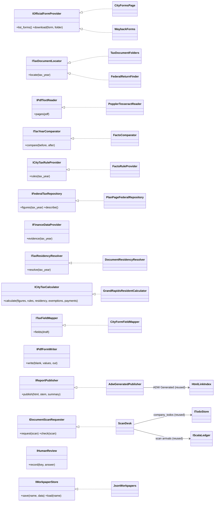
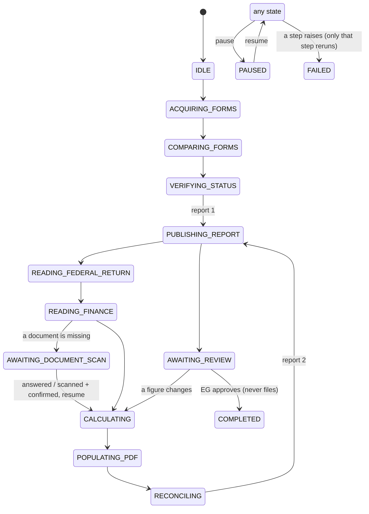
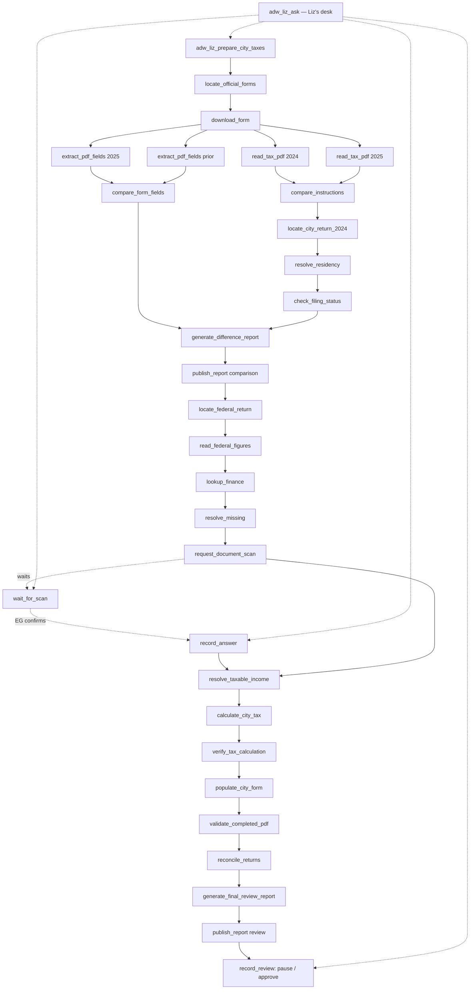

# city_tax — Liz, the Grand Rapids city income tax agent

Liz prepares the **2025 City of Grand Rapids resident return** for Robert and
Rosemary Barnes as a reviewable draft. She is Toyota's receptionist engine with
her own persona (`receptionist_team/profiles.py: LIZ`, sidecar `:8772`,
`liz-receptionist.service`, dashboard desk `agent-liz` at `/api/liz-turn`).
She never files, submits, signs or pays anything.

| Where | What |
|---|---|
| `lancedb_memory/city_tax/` | the domain: models, interfaces, rules, comparator, calculator, scans, state, reports |
| `adws/liz_adw.py` | the shared ADW harness and composition root |
| `adws/adw_liz_*.py` | one ADW per step (28 files) |
| `~/liz_city_tax/` (0700) | forms, workpapers (`work/*.json`), `state.json`, private reports, `drafts/` |
| ADW Generated | the two published review pages only |

```bash
cd ~/agent_blocks
lancedb_memory/.venv/bin/python adws/adw_liz_prepare_city_taxes.py                 # run / resume
lancedb_memory/.venv/bin/python adws/adw_liz_prepare_city_taxes.py --draft-while-waiting
lancedb_memory/.venv/bin/python adws/adw_liz_ask.py --request "what are we missing?"
cd lancedb_memory && .venv/bin/python -m city_tax.tests.test_city_tax                  # offline tests
```

## Rules this package keeps

* **Sources, not memory.** Every figure is a `Figure` with `SourceRef`s and a
  status: `verified`, `provisional` or `missing`. A missing figure is `None`,
  never zero and never last year's amount. Any total that depends on it is blank too.
* **The 2025 federal return is not filed.** The figures come from the newest
  published *Barnes 2025 Tax Plan* page (`PlanPageFederalRepository`) and are
  provisional. When a filed return exists, a repository over it replaces this
  one in `adw_liz_read_federal_figures.py` and nothing downstream changes.
* **The official forms decide.** Rates, the exemption amount and the due date
  are read from each year's own official packet (`compare.read_year`). A rule a
  packet doesn't state raises an error instead of falling back to a remembered rate.
* **Last year's return is read off its image**, and kept only if its arithmetic
  closes. The saved JSON extract once disagreed with the return's tax line by $20.
* **Residency is never inferred from a ZIP code.** It needs the prior resident
  return plus the unchanged address. The city's street-directory check needs a person.
* **A wording change is not a law change.** Each difference is `unchanged`,
  `cosmetic`, `substantive` or `uncertain`.

## Interfaces (program to these)



Reused rather than restated: `HtmlLinkIndex` (ADW Generated), `ReadOnlyBooks` /
`PyMySQLLiveBooks` (live books, read only), `company_todos` (asking a person),
Scala's ledger and `TesseractOcr` (scans and OCR), and SSSF sessions (ADW logs).

## Workflow states



## The ADW graph



## A missing document

```mermaid
sequenceDiagram
    actor EG
    participant Liz as Liz (sidecar :8772)
    participant Desk as adw_liz_ask
    participant Todo as company to-do list
    participant Scala as Scala's ledger
    Liz->>Todo: "Liz needs a scan: 2025 city payment record" (#N)
    Note over Liz: AWAITING_DOCUMENT_SCAN
    EG->>Liz: "I've finished scanning it."
    Liz->>Desk: wait_for_scan
    Desk->>Scala: first scan logged after the request
    Desk-->>EG: "It shows $350.00, $0.00 — which is it? I won't guess."
    EG->>Liz: "The payment was $350.00"
    Desk->>Todo: check #N off
    Note over Desk: payments_2025 = EG's answer; later checkpoints cleared
    EG->>Liz: "Resume the tax preparation."
    Desk->>Desk: prepare_city_taxes (recalculates from resolve_taxable_income)
    Desk-->>EG: "The draft is ready for your review … nothing filed or paid."
```
