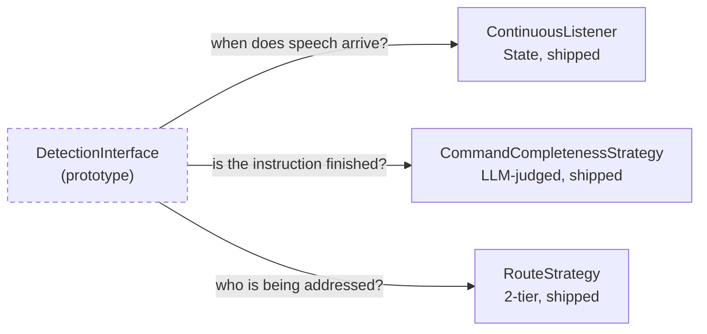

# DetectionInterface

> The prototype's turn-detection seam. Replaced by three narrower shipped seams, not one.

**Superseded / History** — Real code, real implementations, but only in /home/adamsl/voice_agent — nothing in the dashboard uses it.

## Responsibility

- In the prototype: decide when to start recording and when to stop, given raw audio blocks and a frame count. Two implementations answered it — press a key, or wait for silence.
- It was the prototype's best seam. The plan's audit called it 'a good early Strategy seam' while noting it conflated three jobs: start policy, stop policy, and terminal presentation — and forced KeyboardDetection to accept audio arguments it never used, which is an Interface Segregation failure.
- The interesting finding for this workspace is what replaced it. 'Detection' did not become one interface in the shipped system; it became three, each with a different reason to change: when speech arrives (ContinuousListener), who is being addressed (RouteStrategy), and whether the instruction is finished (CommandCompletenessStrategy).

## Contract

```python
DetectionInterface(ABC)   voice_agent/audio_capture/detection_interface.py

  should_start_recording()                    -> bool
  should_stop_recording(audio_block, frames)  -> bool
  reset()                                     -> None

Note the segregation problem: KeyboardDetection must accept
audio_block and frame_count, and ignores both.
```

## Implementations

- **KeyboardDetection** (deprecated) — `voice_agent/audio_capture/keyboard_detection.py`
  Press-to-talk. Ignores the audio arguments it is forced to accept.
- **SilenceDetection** (deprecated) — `voice_agent/audio_capture/silence_detection.py`
  Amplitude-threshold stop policy — the fixed-timeout approach the note-command channel deliberately rejects.
- **ContinuousListener** (current) — `js/abstract/continuous-listener.interface.js`
  Successor for 'when does speech arrive' — see the Audio Capture tab.
- **CommandCompletenessStrategy** (current) — `voice/note_ports.py`
  Successor for 'is the user finished' — judged from text, not silence.
- **RouteStrategy** (current) — `router/classify.py`
  Successor for 'who is being addressed'.

## One interface became three

Each successor has a different reason to change, which is why they did not merge back into a single detection port.



## Tests

- `voice_agent/test_voice_capture.py, test_recording_process*.py`
  Prototype-level capture behaviour including a mock audio generator. Useful as fixtures; not run by the dashboard suite.

### Not covered

- Nothing in the dashboard test suite covers this file — it is outside the repo.

### Tests to write

- No new tests. If the Pipecat rebuild starts, convert the prototype's recordings into characterization fixtures as Phase 0 requires.

## Development status

### Done

- Two working implementations exist in the prototype and prove the Strategy shape was right.
- Its lesson is captured in the shipped design: turn-end is a policy, not a timer.

### Gaps

- Not used by anything that runs today.
- Cannot be ported as-is: it is built on numpy audio blocks, while the shipped browser path never sees raw audio.
- The plan's intended replacement (Pipecat VAD + a Smart Turn strategy) has not been started.

## Dependencies

### Depends on

- numpy
- sounddevice
- terminal output

### Used by

- AudioCapture (prototype only)

The prototype's detection code depended directly on numpy arrays and printed to the terminal, which is why it cannot be reused in a browser context.

## Next work

- Leave it alone. It is history, and the plan explicitly says not to port it.
- If the Pipecat slice ever starts, harvest its WSL device-discovery notes and recordings as fixtures rather than code.
