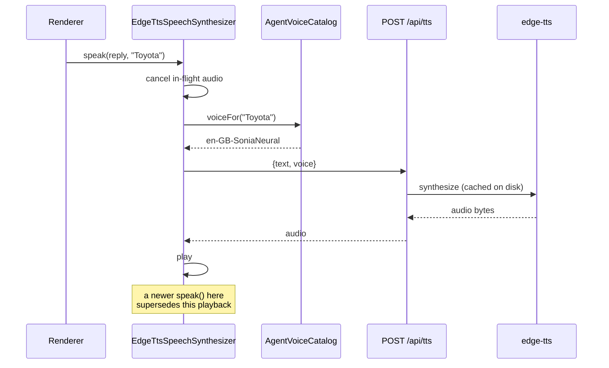
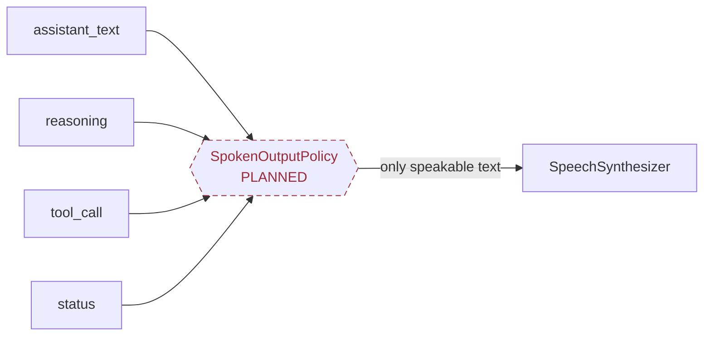

# SpeechSynthesizer

> Text → spoken reply. Server-side edge-tts, with a per-agent voice catalog and no-overlap guarantee.

**Working / Needs Testing** — Works and is well tested, but it is the one place a crude form of generation fencing already exists — worth harvesting when VoiceSession lands.

## Responsibility

- Speak an assistant reply, in the voice assigned to the agent that produced it, without ever overlapping a previous reply.
- There are two layers: a Python strategy that renders text to audio bytes via edge-tts and caches the result, and a browser-side synthesizer facade that cleans markdown out of the text, picks the right voice, and plays the audio.
- The browser side already enforces something the rest of the system lacks: a newer speak() supersedes an in-flight one. That is generation fencing in miniature, implemented locally because there was no session to ask.

## Contract

```text
SpeechSynthesisStrategy(ABC)   voice/synthesis.py   (server)

  synthesize(text, voice) -> audio bytes        cached on disk

SpeechSynthesizer   js/abstract/speech-synthesizer.interface.js   (browser)

  supported            -> bool
  speak(text, agentName=null)   cancels any in-flight speech first
  cancel()
  clean(text)          strips markdown so it is not read aloud
  pickVoice() / refreshVoices()

AgentVoiceCatalog   js/abstract/agent-voice-catalog.interface.js
  voiceFor(agentName) -> voice   per-agent preference + gender heuristics
```

## Implementations

- **EdgeTtsSynthesizer** (current) — `voice/synthesis.py`
  Server-side edge-tts with on-disk caching.
- **EdgeTtsSpeechSynthesizer** (current) — `js/implementation/edge-tts-speech-synthesizer.js`
  The live browser path: POSTs /api/tts and plays the audio.
- **BrowserSpeechSynthesizer** (deprecated) — `js/implementation/browser-speech-synthesizer.js`
  Web Speech fallback. Deliberately never substituted for a failed server call — a robotic voice mid-conversation was worse than silence.

## Speaking one reply

The supersede step is local generation fencing. When VoiceSession exists, this logic should move behind it rather than being reimplemented.



## The missing output gate

Today each renderer decides what is speakable. SpokenOutputPolicy would make that one composable chain instead.



## Tests

- `js/tests/edge-tts-speech-synthesizer.test.js` — 12 tests
  The server path end to end, voice overrides per agent, that a newer speak supersedes an in-flight one, and that three distinct server/playback failures never fall back to a browser voice.
- `js/tests/speech-synthesizer.test.js` — 9 tests
  Voice selection preferences, markdown cleaning, cancel-then-speak ordering, and that abstract primitives throw on the base class.
- `js/tests/agent-voice-catalog.test.js` — 7 tests
  Per-agent voice assignment and the gender-preference heuristics.
- `dashboard/tests/test_synthesis.py` — 4 tests
  edge-tts invocation and caching, plus that invalid input, a missing binary, a process failure and a timeout are all reported rather than producing empty audio.

### Not covered

- Nothing asserts that reasoning or tool-call text is never passed to speak() — that rule lives in renderer code and is unprotected.
- Barge-in, because it does not exist.

### Tests to write

- A SpokenOutputPolicy with a test proving reasoning/tool/status events are rejected. This is the plan's Chain-of-Responsibility object and the one piece of it worth building before the rest.

## Development status

### Done

- Replies never overlap: speak() cancels in-flight audio, and a newer speak supersedes an older one.
- Markdown is stripped before speaking, and text that is only markdown says nothing rather than reading punctuation aloud.
- Per-agent voices persist to both localStorage and Letta agent metadata, with the local cache used when metadata is unavailable.
- Three separate failure modes are covered by tests and all resolve to silence rather than a robotic fallback: non-audio server reply, rejected fetch, and blocked playback.
- Server-side synthesis is cached on disk, so repeated phrases do not re-synthesize.

### Gaps

- The no-overlap rule is enforced inside the synthesizer rather than by a session, so it only knows about speech, not about which agent turn the speech belonged to.
- There is no SpokenOutputPolicy: nothing centrally decides that reasoning, tool calls and status events must never be spoken. Each renderer composes speakable text itself.
- No barge-in — speaking does not stop because the user started talking.

## Dependencies

### Depends on

- edge-tts (server)
- HTMLAudioElement (browser)
- POST /api/tts

### Used by

- InputOptionsRenderer — speaks agent replies
- Toyota's receptionist box

The browser facade holds no voice policy of its own — AgentVoiceCatalog owns per-agent voice choice, so adding an agent does not touch the synthesizer.

## Next work

- Build SpokenOutputPolicy as composable gates, with a failing test for 'reasoning is never spoken'.
- Move the supersede rule behind VoiceSession once it exists, instead of keeping it inside the synthesizer.
- Add barge-in after ContinuousListener can signal speech start.
