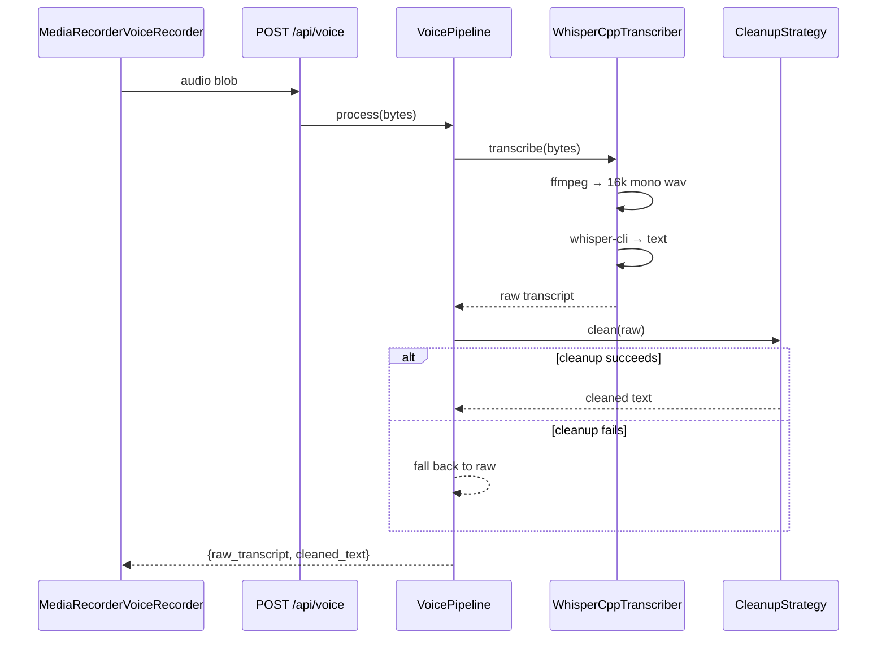

# TranscriptionStrategy

> Audio bytes → raw text, via whisper.cpp. The most thoroughly tested port here.

**Finished** — Complete and stable. 10 tests, plus 5 covering the pipeline that composes it.

## Responsibility

- Convert an uploaded audio blob into raw text. One method, one job.
- The concrete implementation shells out: ffmpeg normalises whatever the browser recorded into 16 kHz mono PCM, then whisper-cli transcribes it. Both binaries are borrowed from lettabot rather than reinstalled, and every path is env-overridable.
- It is paired with, but separate from, CleanupStrategy. Transcription produces what was heard; cleanup fixes what was misheard. Keeping them apart is what lets voice_transcripts.json log both and make mis-heard agent names diagnosable.

## Contract

WHISPER_PROMPT biases whisper toward the real agent names up front, so 'Mazda' is not heard as 'Melissa' in the first place.

```python
TranscriptionStrategy(ABC)   voice/transcription.py

  transcribe(audio_bytes, filename) -> str      raises TranscriptionError

VoicePipeline   voice/pipeline.py    (composes transcribe -> cleanup)

  process(audio_bytes, filename) -> {raw_transcript, cleaned_text}

Pure arg-builders, tested independently of any subprocess:
  build_ffmpeg_args(...)     forces 16k mono PCM
  build_whisper_args(...)    text output, optional threads, optional prompt
```

## Implementations

- **WhisperCppTranscriber** (current) — `voice/transcription.py`
  ffmpeg → 16k wav → whisper-cli (small.en since 2026-08-08).
- **Pipecat WhisperSTTService** (planned) — `/home/adamsl/talking_agent_parts/`
  The plan's Phase 2 would start here before writing any custom STT adapter.

## The push-to-talk leg

Two subprocesses behind one port method. Cleanup is a separate strategy so a cleanup failure cannot lose the transcript.



## Tests

- `dashboard/tests/test_transcription.py` — 10 tests
  Every argument the two binaries receive, prompt inclusion and omission, the happy path's ffmpeg-then-whisper ordering, and that a missing binary or empty output raises rather than returning ''.
- `dashboard/tests/test_pipeline.py` — 5 tests
  raw + cleaned are both returned, cleanup failure falls back to raw, and an empty upload is rejected before any work starts.

### Not covered

- Behaviour on a corrupt or non-audio upload — ffmpeg's failure mode is not covered.
- Concurrency: two uploads transcribing at once share the temp-file naming scheme.

### Tests to write

- A corrupt-upload test asserting a clean TranscriptionError rather than a stack trace.
- Latency capture, so the Pipecat decision can be made against measured numbers instead of guesses.

## Development status

### Done

- Argument construction is pinned by tests: 16 kHz mono PCM, text output, optional thread count, optional initial prompt.
- A missing binary and an empty transcription both raise TranscriptionError rather than returning silence as success.
- The default model path is asserted against the model actually installed, so a model upgrade cannot silently drift from the test.
- VoicePipeline falls back to the raw transcript if cleanup fails — speech is never lost to a cleanup error.

### Gaps

- Synchronous and blocking: a ~5s transcription occupies a request thread. Tolerable only because the HTTP server is threaded.
- No streaming/partial transcription, so push-to-talk cannot show text as you speak.
- No latency instrumentation — the plan's Phase 0 asks for measured end-of-speech→transcript timings, which have never been captured.

## Dependencies

### Depends on

- whisper-cli binary
- ffmpeg binary
- filesystem temp files

### Used by

- VoicePipeline → POST /api/voice → MediaRecorderVoiceRecorder

The arg-builders are pure functions, so the argument contract is tested without running either binary. Only two tests actually stub subprocess.

## Next work

- Capture baseline latency (end-of-speech → transcript) on the live box.
- Add a corrupt-audio test.
- Leave the rest alone — this port is done and does not need work for its own sake.
