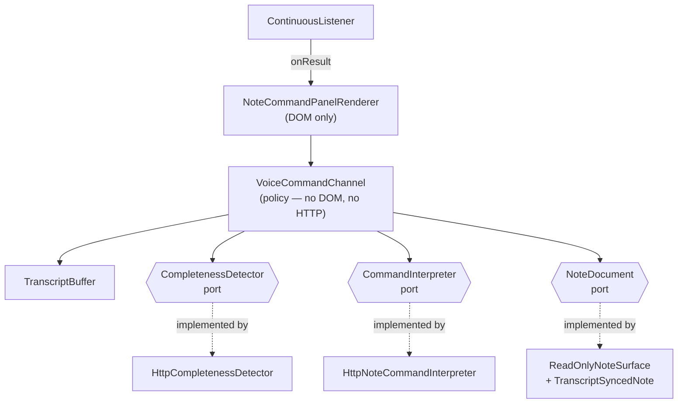
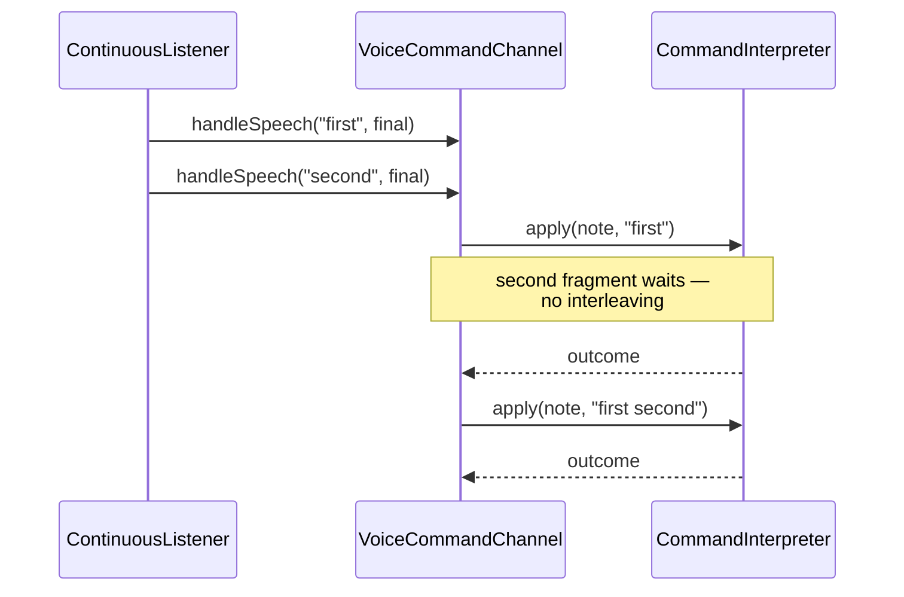

# ConversationCoordinator

> Plan: one finalized turn → one agent run. Reality: VoiceCommandChannel does this, for note commands only.

**Partial** — A real, tested coordinator exists — but it coordinates note edits, not agent conversation turns.

## Responsibility

- Coordinate one finalized user turn into exactly one agent run, and make sure overlapping speech never produces overlapping responses. It is the Mediator between capture, the agent, and output.
- The shipped VoiceCommandChannel already owns a meaningful piece of this: it serialises work onto a promise chain, dedupes identical finalized transcripts, and decides when an instruction is complete enough to act on. That last decision — completeness judged from accumulated text rather than a silence timer — is the part worth keeping in any rebuild.
- What it does not do is coordinate a conversation with an agent. It routes note-edit commands. Turn coordination for actual dialogue still lives in renderer closures.

## Contract

No DOM and no HTTP in this class — both collaborators are duck-typed ports supplied by the composition root.

```js
VoiceCommandChannel   js/abstract/voice-command-channel.js   (shipped)

  handleSpeech(text, isFinal)  -> Promise   buffer, then assess when final
  submit(text)                 -> Promise   typed command; skips the detector
  clear()                      -> void      forget the accumulated instruction
  get busy                     -> boolean   work in flight
  get commandText              -> string

  injected collaborators:
    note                 NoteDocument
    completenessDetector { assess(text) -> {complete, reason} }
    commandInterpreter   { apply(note, command) -> NoteCommandOutcome }
    buffer               TranscriptBuffer
```

## Implementations

- **VoiceCommandChannel** (current) — `js/abstract/voice-command-channel.js`
  Coordinates note-edit commands. Serialised queue, dedupe, completeness gating.
- **NoteCommandPanelRenderer** (current) — `js/implementation/note-command-panel.js`
  Binds the channel to DOM and a ContinuousListener. Holds no policy.
- **ConversationCoordinator** (planned) — `/home/adamsl/talking_agent_parts/`
  The dialogue-turn coordinator — the last of the plan's core objects with no code. Would consult VoiceSession, which now exists, for generation fencing.

## Where the coordinator sits

Everything the channel touches is an injected contract. The concrete HTTP adapters are supplied at the composition root and can be swapped for local implementations without editing the channel.



## Serialised queue under overlapping speech

Both fragments arrive before any work resolves. The queue guarantees ordering; it does not yet guarantee the first result is still wanted — that needs VoiceSession.



## Tests

- `js/tests/voice-command-channel.test.js` — 13 tests
  The headline pause behaviour ('Put a' waits, 'Put a period at the end' executes), interim results are never assessed, identical text is not assessed twice, rejected commands preserve state, typed submit skips the detector, and queued work never interleaves.
- `js/tests/note-command-panel.test.js` — 7 tests
  The DOM binding: the command box is separate from the note, Run executes typed text without the detector, Clear empties the command without touching the note, listener errors are reported.

### Not covered

- Cancellation — there is nothing to test yet.
- Behaviour when the detector never resolves (a hung Letta call rather than a failing one).
- Two coordinators sharing one microphone.

### Tests to write

- 'A superseded command's result is discarded' — now writable against the real VoiceSession rather than blocked on it.
- A hung-collaborator test using a promise that never settles, asserting the UI is not left permanently busy.

## Development status

### Done

- Work is serialised on a promise chain, so an in-flight edit cannot interleave with the next speech fragment.
- Identical finalized text is never assessed twice — important because the recognizer re-flushes its tail on every silence restart.
- Completeness is judged from accumulated text via an injected detector, never from a silence timeout.
- A rejected command leaves both the note and the command text alone, so the user can reword and retry.
- Errors from either collaborator surface as status without wedging the queue.

### Gaps

- Coordinates note edits only. There is no coordinator for a dialogue turn with an agent.
- No generation fencing — it cannot discard a superseded result, only refuse to start overlapping work. VoiceSession now exists to fix this; the channel does not hold one yet.
- Cancellation does not exist; a queued command cannot be abandoned once enqueued.
- The pending-work counter is not exposed to the UI, so a long interpretation shows no progress indicator.

## Dependencies

### Depends on

- NoteDocument — the surface being edited
- A completeness detector port — { assess(text) }
- A command interpreter port — { apply(note, command) }
- TranscriptBuffer — final/interim accumulation

### Used by

- NoteCommandPanelRenderer (browser)

Dependency direction is correct here: the channel depends only on injected contracts, and the HTTP adapters that satisfy them live in js/implementation/. This is the cleanest boundary in the whole voice system and is the model the rest should follow.

## Next work

- Expose `busy` to the panel so a long interpretation shows a spinner instead of looking dead.
- Add cancellation: an AbortSignal threaded through both collaborator ports.
- Give the channel a VoiceSession and tag enqueued work with a generation id, then discard results whose generation was superseded. The session and the fence exist; the channel is the natural first caller because it already serialises work.
- Extract the queue/dedupe logic once a second coordinator (dialogue turns) needs it — not before.
