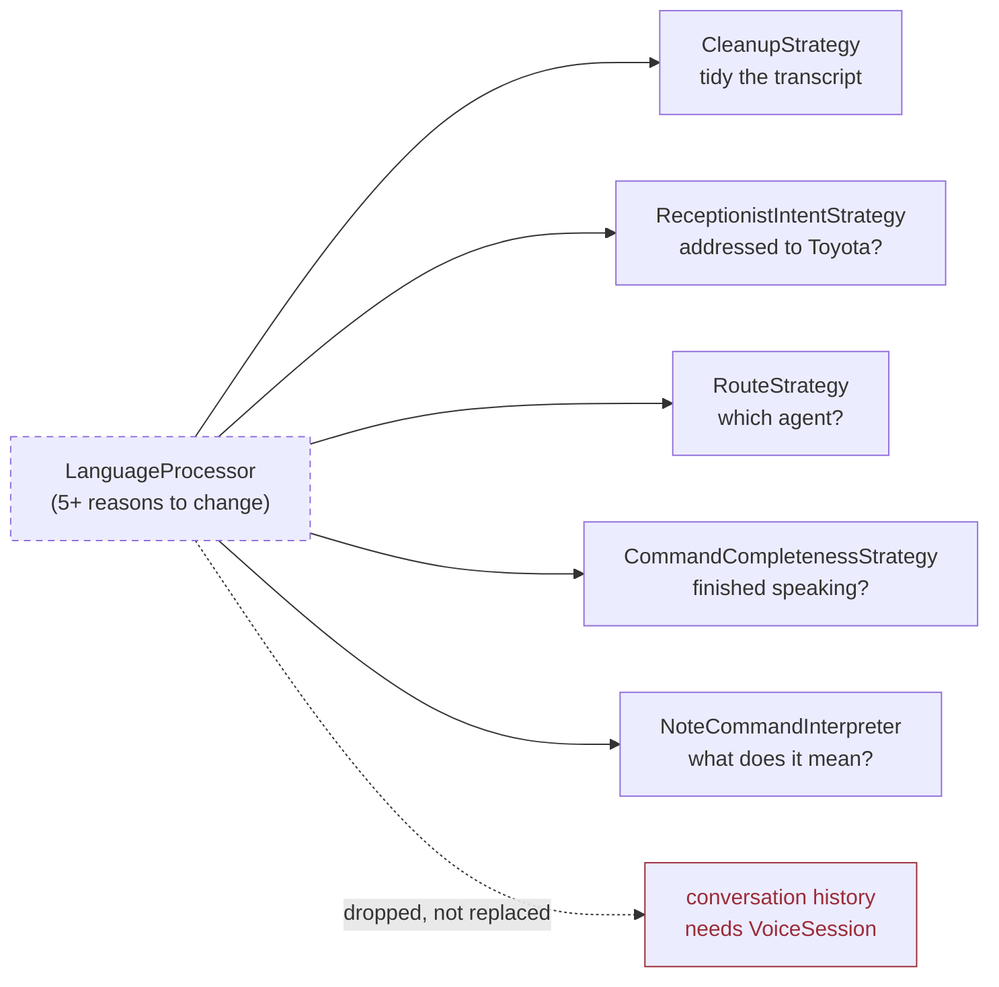
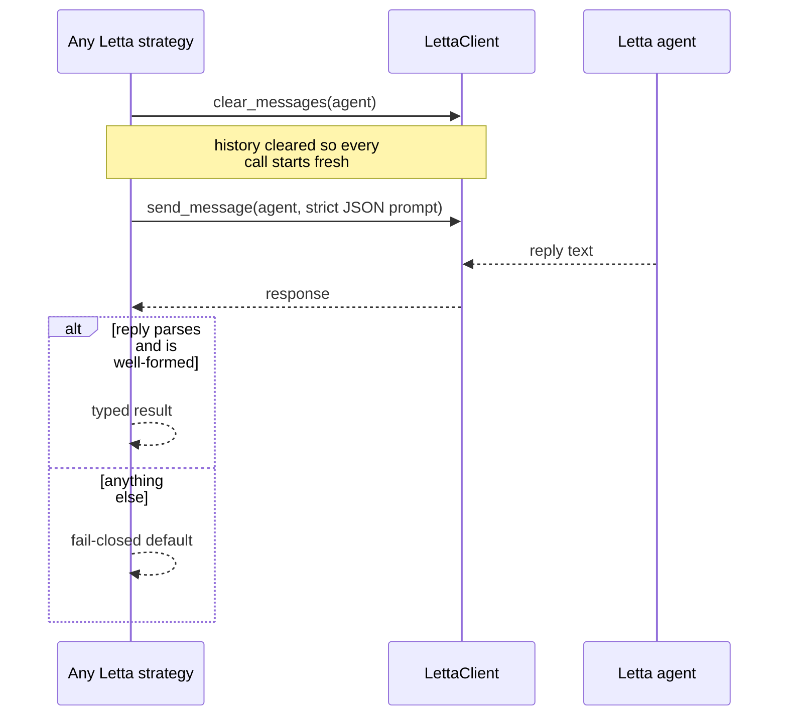

# LanguageProcessor

> The prototype's do-everything LLM class. Replaced by five narrow, fail-closed strategies.

**Superseded / History** — The plan explicitly says: do not port. Superseded, and better for it.

## Responsibility

- In the prototype: construct the OpenAI client, hold the system prompt, store conversation history, enforce token policy, translate errors, and detect exit commands — all in one class.
- That is at least five reasons to change, and the plan's audit flagged it as the clearest Single Responsibility violation in the prototype.
- The shipped system replaced it with several small strategies that each answer exactly one question and share one shape: clear the agent's history, send one strict-JSON prompt, parse strictly, fail closed. None of them holds conversation state, and none constructs its own client.

## Contract

```python
LanguageProcessor   voice_agent/language_processor/language_processor.py

  process(user_input, use_history=True) -> str
  clear_history() / set_system_prompt() / get_history_length()
  export_history() / import_history()
  is_exit_command(text) -> bool

Replaced by (each one question, one answer):

  CleanupStrategy.clean(transcript)            -> str
  ReceptionistIntentStrategy.evaluate(text)    -> {addressed, cleaned_text}
  RouteStrategy.classify(text)                 -> {agent, remainder}
  CommandCompletenessStrategy.assess(partial)  -> CommandCompleteness
  NoteCommandInterpreter.interpret(request)    -> NoteCommandIntent
```

## Implementations

- **LanguageProcessor** (deprecated) — `voice_agent/language_processor/language_processor.py`
  Prototype only. Constructs its own OpenAI client.
- **LettaAgentCleanup** (current) — `voice/cleanup.py`
  Successor for transcript tidying.
- **LettaReceptionistIntentStrategy** (current) — `voice/receptionist.py`
  Successor for 'is Toyota being addressed'.
- **LettaAgentRouteStrategy** (current) — `router/classify.py`
  Successor for agent-name detection.
- **LettaCommandCompletenessStrategy** (current) — `voice/note_completeness.py`
  Successor for turn-end judgement.
- **LettaNoteCommandInterpreter** (current) — `voice/note_interpreter.py`
  Successor for instruction interpretation.

## One class became five strategies

Each successor answers one question with one strict-JSON call and no retained history.



## The shared shape every successor follows

Identical in all five. The duplication is currently re-tested per file rather than proven once as a contract.



## Tests

- `dashboard/tests/test_cleanup.py` — 7 tests
  Cleanup falls back to the raw transcript rather than losing speech.
- `dashboard/tests/test_receptionist.py` — 5 tests
  Invented model output is refused; only clearly-addressed speech is acted on.
- `dashboard/tests/test_router_classify.py` — 14 tests
  Exact-name matching precedes any LLM call; ambiguity never guesses.
- `dashboard/tests/test_note_commands.py` — 27 tests
  Completeness and interpretation both fail closed on malformed replies.

### Not covered

- Nothing tests the successors as a family — there is no shared contract suite asserting all five behave the same way on a malformed reply, even though they all claim to.

### Tests to write

- A shared 'fail-closed contract' test parameterised over all five strategies. Today each file re-proves the same property separately, which is duplication that will drift.

## Development status

### Done

- Fully superseded. Every job it did has a narrower home in shipped, tested code.
- The fail-closed convention its successors share is now consistent across all five.

### Gaps

- One capability was dropped rather than replaced: multi-turn conversation history. Every shipped strategy clears history deliberately, so nothing in the voice system currently holds a conversation across turns.
- That gap is exactly what IConversationAgent + VoiceSession are for. Until they exist, voice interaction is stateless request/response.

## Dependencies

### Depends on

- openai SDK, directly constructed inside the class

### Used by

- VoiceAgent (prototype only)

The successors depend on an injected client with three methods, never on a concrete SDK. That is the difference that makes all five testable offline.

## Next work

- Extract the shared fail-closed behaviour into one contract test run against all five strategies.
- When IConversationAgent lands, decide deliberately whether multi-turn history returns — it was dropped, not designed away.
