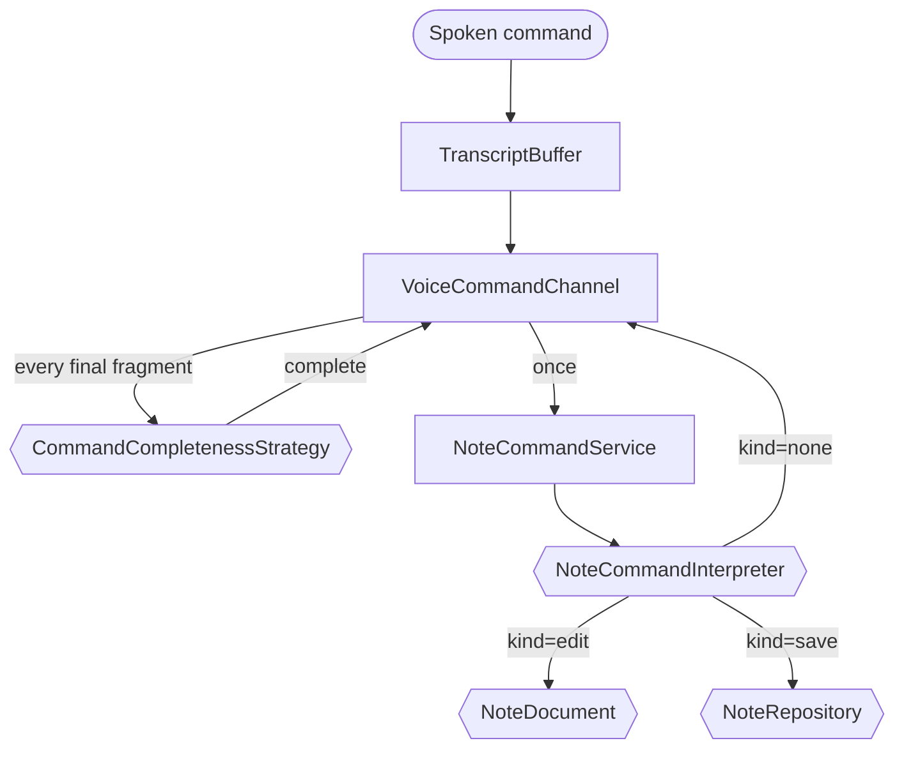
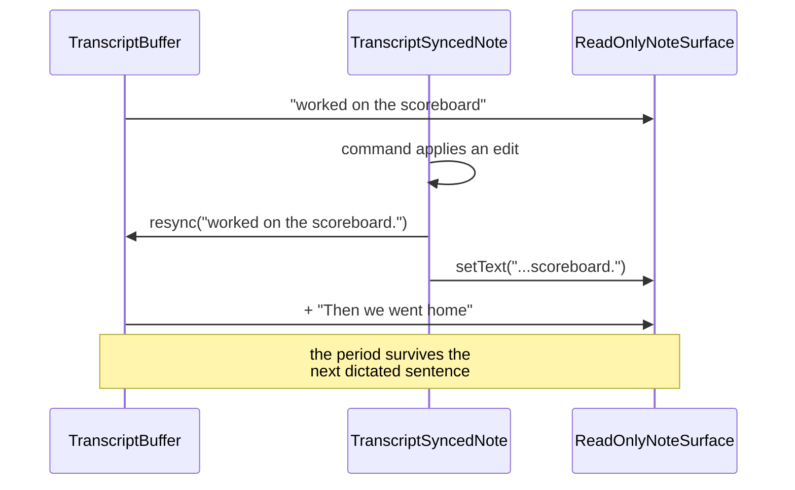

# Note Command Channel

> Four ports that turn spoken instructions into edits on a document. The newest and most complete slice.

**Finished** — Complete end to end and verified live. 68 tests across seven files.

## Responsibility

- Let someone dictate a note into one box and then speak instructions about it into another — 'put a period at the end', 'change Smith to Smythe', 'save this as meeting notes' — without having to speak unnaturally fast.
- Its defining decision is that command completeness is judged from the accumulated text, never from a silence timer. 'Put a' waits indefinitely; 'Put a period at the end' executes. That is what makes the interaction conversational.
- Four narrow ports rather than one: is the instruction finished (CommandCompletenessStrategy), what does it mean (NoteCommandInterpreter), where do notes get stored (NoteRepository), and what surface is being edited (NoteDocument). The editor never learns whether a command came from speech or the keyboard.

## Contract

All models are strict Pydantic (extra='forbid', frozen). An 'edit' carrying empty text is treated as a malformed reply, never as an instruction to blank the note.

```text
CommandCompletenessStrategy(ABC)   voice/note_ports.py
  assess(PartialVoiceCommand) -> CommandCompleteness {complete, reason}

NoteCommandInterpreter(ABC)
  interpret(NoteEditRequest) -> NoteRevision | NoteSaveRequest | NoteCommandRejected
                                (discriminated on "kind")

NoteRepository(ABC)
  save(note, filename="") -> SavedNote      "" means the repo names it

NoteDocument   js/abstract/note-document.interface.js
  getText() setText(text) appendText(text) element editable
```

## Implementations

- **LettaCommandCompletenessStrategy** (current) — `voice/note_completeness.py`
  One strict-JSON call per finalized fragment.
- **LettaNoteCommandInterpreter** (current) — `voice/note_interpreter.py`
  Returns the whole revised note; the outcome kind is discriminated.
- **FilesystemNoteRepository** (current) — `voice/note_repository.py`
  Slugifies the model-supplied name, date-prefixes, and never overwrites.
- **ReadOnlyNoteSurface / EditableTextareaSurface** (current) — `js/implementation/textarea-note-surfaces.js`
  Two NoteDocument implementations; Toyota's note uses the read-only one.
- **TranscriptSyncedNote** (current) — `js/implementation/transcript-synced-note.js`
  Decorator resolving the two-writer problem between dictation and commands.
- **HttpCompletenessDetector / HttpNoteCommandInterpreter** (current) — `js/implementation/http-note-command-services.js`
  Browser adapters that validate responses and fail closed.
- **Local completeness detector** (planned) — `—`
  A non-LLM detector would remove one network round-trip per spoken fragment.

## Four ports, one flow

The interpreter returns a discriminated outcome, so the service branches on a validated tag rather than sniffing which optional keys are present.



## The two-writer problem

Without TranscriptSyncedNote, the buffer's stale copy silently undoes Toyota's edit on the next dictated sentence.



## Tests

- `dashboard/tests/test_note_commands.py` — 27 tests
  Model validation, both strict parsers' fail-closed behaviour, filename slugification and traversal safety, non-overwriting saves, service policy for empty notes and failed writes, and that an unreachable Letta never raises into the handler.
- `js/tests/voice-command-channel.test.js` — 13 tests
  The pause behaviour, interim results never being assessed, dedupe of repeated finals, ordering under overlapping speech, and that rejection preserves state.
- `js/tests/textarea-note-surfaces.test.js` — 8 tests
  Read-only vs editable surfaces, white-on-black note styling, and that an external edit survives the next dictated sentence.
- `js/tests/note-command-panel.test.js` — 7 tests
  The DOM binding and that Clear never touches the note.
- `js/tests/http-note-command-services.test.js` — 7 tests
  Both browser adapters set their own timeouts and fail closed on transport errors.
- `js/tests/note-command-contracts.test.js` — 4 tests
  Runtime validation of both response shapes, including that an empty 'edit' is rejected.
- `js/tests/input-options-note-surface.test.js` — 4 tests
  Sending never wipes a read-only note, while an editable box still clears.

### Not covered

- No test covers a completeness check that hangs rather than fails.
- Nothing asserts behaviour when the note is very large — the whole note is sent on every command.

### Tests to write

- A hung-detector test using a never-settling promise.
- A test for a large note, once a size limit is decided.

## Development status

### Done

- The pause-and-resume behaviour works and is verified against a live agent: 'Put a' → incomplete, 'Put a period at the end' → applied.
- Toyota chooses a sensible filename when the user does not — verified live producing 2026-08-12_scoreboard-work.md.
- Every failure mode fails closed: malformed JSON, contradictory replies, an unreachable Letta, and a 401 all leave the note untouched.
- A model-supplied filename is slugified and date-prefixed, so path traversal cannot escape the notes directory, and saving twice never overwrites.
- The two-writer problem between dictation and commands is solved by a Decorator rather than by coupling the two paths.
- Typed and spoken commands take the identical path into the interpreter.

### Gaps

- Every finalized speech fragment costs one LLM round-trip for the completeness check — the dominant latency and cost in the loop.
- A rejected command explains itself but cannot ask a clarifying question; 'Add a heading' is rejected rather than answered with 'what heading?'.
- No undo. An applied edit replaces the note with no history.
- Live and working since 2026-08-13 on chatgpt-plus-pro/gpt-5.6-luna. The earlier lc-gemini 401 that had this failing closed is resolved — see the LettaAgentAdapter tab.

## Dependencies

### Depends on

- LettaClient (via the two strategies)
- filesystem (NOTES_DIR)
- POST /api/note-command-complete, /api/note-command-apply

### Used by

- VoiceCommandChannel
- NoteCommandPanelRenderer
- Toyota's home-screen note

The layering is clean here: policy (VoiceCommandChannel, NoteCommandService) depends only on ports, and every concrete Letta/HTTP/filesystem detail sits in an adapter constructed at a composition root.

## Next work

- Add a cheap local pre-filter so obviously-incomplete fragments skip the LLM round-trip entirely.
- Let a rejected command ask one clarifying question instead of just refusing.
- Add undo — keep the previous note text and a 'revert that' command.
- Add the hung-detector test.
