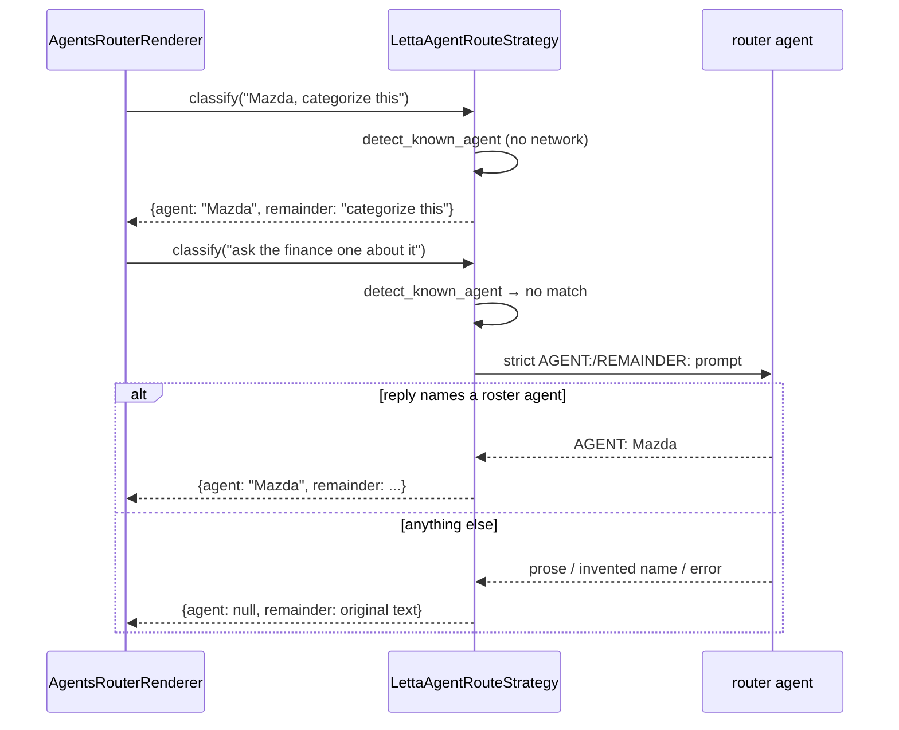

# RouteStrategy

> Transcript → which agent is being addressed. Two tiers, and it always fails closed.

**Finished** — Complete, 14 tests, and the fail-closed rule is enforced by them.

## Responsibility

- Decide whether a piece of speech names a known agent, and if so, return the text that follows the name so it can be forwarded.
- It has two tiers on purpose. An exact known name is matched deterministically with no LLM call at all — that is the hands-free path, and it must not depend on a model round-trip. Only ambiguous phrasing reaches the Letta router agent.
- Its hard rule is that ambiguity never guesses. Misrouting a message to the wrong agent is worse than not routing it, so every parse failure, exception, and unrecognised name resolves to 'no agent detected'.

## Contract

```python
RouteStrategy(ABC)   router/classify.py

  classify(text) -> {"agent": <name or None>, "remainder": <text after name>}

Tier 1 — deterministic, no network:
  detect_known_agent(text, known_names)
    longest name first; letter/digit boundaries so
    "Mazda Router" wins over "Mazda", and "amazda" never matches

Tier 2 — Letta router agent, then strict parse:
  parse_router_reply(reply, known_names, original_text)
    an invented or fuzzy-matched name is rejected outright
```

## Implementations

- **LettaAgentRouteStrategy** (current) — `router/classify.py`
  Both tiers. Falls back to tier-1-only when no router agent resolves.
- **AgentsRouterRenderer** (current) — `js/implementation/agents-router-renderer.js`
  The browser caller: hands off to the detected agent's page without stopping listening.

## Two-tier detection

The LLM is the fallback, not the primary. That ordering is what keeps hands-free routing working when the model is down — which is the situation today.



## Tests

- `dashboard/tests/test_router_classify.py` — 14 tests
  Exact-name detection runs without touching the network, boundary rules (multi-word names, substrings, punctuation), and that every malformed or invented model reply fails closed to no-agent with the original text intact.
- `js/tests/agents-router-renderer.test.js` — 11 tests
  The browser side: detection during live listening stays quiet until a name appears, routing hands off the remainder, and listening survives the hand-off.

### Not covered

- Tier-2 remainder fidelity — nothing asserts the forwarded text is a substring of what the user actually said.
- Two agents named in one sentence.

### Tests to write

- A test pinning tier-2 remainder to a slice of the original transcript, closing the paraphrase risk.
- A decision (then a test) for what 'Mazda and Frita' should do.

## Development status

### Done

- Tier 1 runs before any network call, so exact names route instantly and work with Letta down.
- Longest-name-first matching means multi-word agent names beat their own prefixes.
- Word-boundary matching uses letter/digit lookaround rather than \b, so punctuation-adjacent names still match while substrings do not.
- Every failure path — no reply, unparseable reply, unknown name, exception — returns 'no agent' with the original text preserved.
- The model is never trusted to name an agent that is not already on the roster.

### Gaps

- The remainder for tier 2 comes from the model rather than being sliced from the original text, so a model that paraphrases could silently alter the forwarded message.
- No confidence signal — the caller cannot distinguish 'certainly Mazda' from 'probably Mazda'.
- Depends on the same shared worker agent that is currently 401ing, so tier 2 is effectively offline right now (tier 1 still works).

## Dependencies

### Depends on

- LettaClient
- router/config.py ROUTER_AGENT_NAMES (top-level roster only)

### Used by

- POST /api/route-detect
- AgentsRouterRenderer on #agents-home

Routable names are deliberately the top-level roster, not sub-agents, so 'Mazda Parser' cannot be addressed directly by accident.

## Next work

- Slice the tier-2 remainder from the original transcript instead of trusting the model's copy.
- Decide the multi-agent sentence rule.
- Leave the tier ordering exactly as it is — it is the reason routing degrades gracefully.
