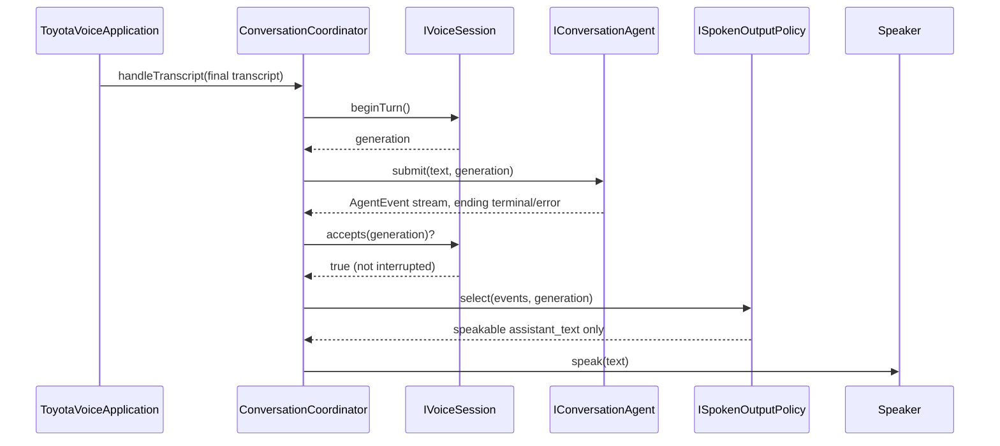

# IToyotaVoiceApplication

> The composition root. One class names every other concrete class in this tree, on purpose — that is its entire job.

**Partial** — `ToyotaVoiceApplication` exists and is tested end to end from raw text to a fake speaker, but it holds no real `IPipecatServiceClient` and no real capture/transcription path feeds it yet.

## Responsibility

- The Facade GoF role named for this port in the root `CLAUDE.md`. Its constructor is the one place in this tree allowed to name a concrete `IConversationAgent`, `IVoiceSession`, and `ISpokenOutputPolicy` together — everything else here, including `ConversationCoordinator`, depends only on their ports.
- It does not implement turn logic itself. It builds a `ConversationCoordinator` from its three dependencies plus a `Speaker` callback and delegates to it; `start()`/`stop()` are this object's own lifecycle, `stop()` closing the coordinator's session.
- `Speaker` (`(text: string) => void`) is deliberately not a new port in `interfaces/index.ts`. Real speech output belongs to Pipecat/Python once `IPipecatServiceClient` has a caller (see that block's Next work); until then this is a plain callback a test or a future renderer supplies.

## Contract

```ts
IToyotaVoiceApplication   toyota_voice_application.ts

  start() -> Promise<void>
  stop()  -> Promise<void>

ToyotaVoiceApplication   toyota_voice_application.ts   (current)

  constructor(agent, session, policy, speak: Speaker)
  runTurn(text: string) -> Promise<void>   test/composition-root convenience:
                                            wraps text as a final TranscriptEvent
                                            and hands it to its ConversationCoordinator
```

## Implementations

- **ToyotaVoiceApplication** (current) — `toyota_voice_application.ts`
  Holds one `ConversationCoordinator`; adds no turn logic of its own.

## The turn, end to end



## Tests

- `toyota_voice_application.test.ts` — 1 test
  A `FakeConversationAgent` scripted with a `reasoning` event and an `assistant_text` reply proves only the latter reaches the fake speaker — the step-5 DONE WHEN from `docs/build_plan.md`.

### Not covered

- `start()`/`stop()` themselves have no dedicated test — `start()` is currently a no-op, and `stop()`'s session-closing effect is exercised indirectly via `ConversationCoordinator`'s own tests, not through this class.
- Anything with a real `IPipecatServiceClient` or real capture — nothing produces a `TranscriptEvent` for this object in production yet.

## Development status

### Done

- Composes a real `IConversationAgent`, `IVoiceSession`, and `ISpokenOutputPolicy` into one working turn, provably: a non-speakable event from the current generation is filtered exactly where `SpokenOutputPolicy`'s own tests say it should be.

### Gaps

- No real caller constructs this with `LettaAgentAdapter` — every existing test uses `FakeConversationAgent`.
- No `IPipecatServiceClient` dependency yet, so there is no path from here to actually speaking through Pipecat; `Speaker` is a stand-in.

## Dependencies

### Depends on

- `IConversationAgent`, `IVoiceSession`, `ISpokenOutputPolicy` — ports only, selected concretely by whatever constructs this class
- `ConversationCoordinator` (concrete) — the one non-port dependency, since composing it is this class's entire job

### Used by

- Nobody yet — no real entry point in `ts/` constructs a `ToyotaVoiceApplication`.

## Next work

- Give this class a real `IPipecatServiceClient` and let `Speaker` become "send a `SpeakRequest` to Pipecat" instead of a bare callback.
- Wire an actual capture source (browser `SpeechRecognition`, or `IPipecatServiceClient` streaming transcripts back) that calls `ConversationCoordinator.handleTranscript` for real, so this facade has a live caller.
